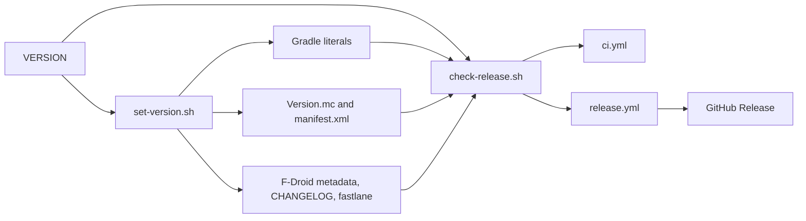
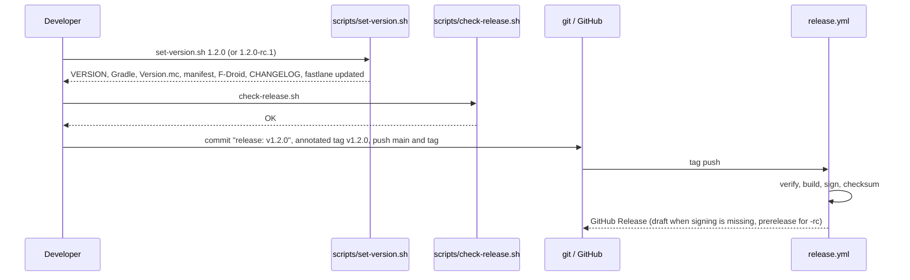
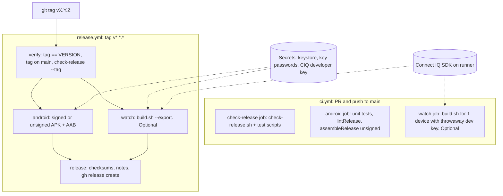

# Design Document: Apache License, CI and Release Automation

## Overview

This feature does four things:

1. Relicenses the repository from `GPL-3.0-or-later` to `Apache-2.0`, because the GPL is a poor fit for an app that depends on Garmin's proprietary Connect IQ SDKs.
2. Introduces semantic versioning with a single source of truth, a `VERSION` file at the repository root. One script (`scripts/set-version.sh`) propagates it to every place that carries a version, and `scripts/check-release.sh` verifies that nothing drifted.
3. Adds GitHub Actions: a CI workflow for pull requests and pushes, and a release workflow triggered by a `v<MAJOR>.<MINOR>.<PATCH>[-rc.<N>]` tag. The release workflow builds the signed Android APK and AAB, optionally builds the Connect IQ `.iq` export, and publishes a GitHub Release with checksums and changelog notes.
4. Keeps the short git commit visible in the watch app (`v<SEMVER> (<COMMIT>)`), including in CI and release builds.

It builds on `.kiro/specs/pntome-store-release/` (rename to PNTome/PNTomeGo, signing, `--export`, `check-release.sh`). That spec's changes are, at the time of writing, still uncommitted in the working tree. They must be committed before this feature is implemented, because the CI workflows run against committed files.

Nothing in this design is legal advice. Where a statement depends on Garmin's license text or on GitHub/Garmin account terms, the design says what must be verified instead of assuming an answer.

## Findings From Repo Investigation

| Area | Current state | Consequence |
|---|---|---|
| Authors | `git shortlog` shows one author (22 commits). The copyright holder is a single person | Relicensing needs no third-party consent. The owner confirms this in the task list (not legal advice) |
| License text | `LICENSE` is the 674-line GPLv3 text. No `NOTICE` file. No SPDX headers in source files | Replace text, add `NOTICE`. Per-file headers are not added (same choice as the previous spec) |
| License mentions | `README.md` (tree comment line 62, "License" section lines 149 to 152), `THIRD_PARTY.md` (open item lines 33 to 47), `CHANGELOG.md` (line 26), `docs/RELEASE_CHECKLIST.md` (line 70), `fdroid/metadata/dev.pntome.app.yml` (`License:` line 3), `PNTome/fastlane/metadata/android/en-US/full_description.txt` (line 19), `store/*` texts | All updated. A grep check in `check-release.sh` prevents regressions |
| Third-party deps | All runtime deps in `THIRD_PARTY.md` are Apache-2.0 or BSD-3-Clause, except the proprietary Garmin Connect IQ Mobile SDK | No dependency forces copyleft. Apache-2.0 is compatible with all of them |
| Version literals | Android `versionName = "0.1.0"`, `versionCode = 1` in `PNTome/app/build.gradle.kts`; `PNTomeGo/source/Version.mc` `SEMVER = "0.1.0"`, `COMMIT = "dev"`; `PNTomeGo/manifest.xml` `version="0.1.0"`; F-Droid `Builds`, `CurrentVersion*`, `UpdateCheckData`; `fastlane/.../changelogs/1.txt`; `CHANGELOG.md` | Five places plus one file name to keep in sync |
| `check-release.sh` | `check_versions` (line 229) requires `versionName == SEMVER == manifest version`. `check_fdroid_metadata` and `check_store_text_limits` parse `versionCode` as a literal | Must be made version-aware (VERSION file, pre-releases, computed versionCode) |
| `build.sh` | `--export` writes `dist/PNTomeGo-<SEMVER>.iq`, refuses a dirty tree (`git status --porcelain`), stamps `git rev-parse --short HEAD` into `Version.mc` and restores the file on exit; non-export builds append `-dirty` when `git diff --quiet` fails | Works in CI as is, provided the SDK and key live outside the workspace so the tree stays clean |
| CI | No `.github/` directory. Remote is `git@github.com:pn-developer/pntome.git` | Create `.github/workflows/` |
| Gradle | AGP 8.7.3, Kotlin 2.0.21, JDK 17 target, wrapper present, `compileSdk = targetSdk = 35`; signing from `PNTOME_KEYSTORE_FILE`, `PNTOME_KEYSTORE_PASSWORD`, `PNTOME_KEY_ALIAS`, `PNTOME_KEY_PASSWORD`; unsigned fallback with warning; fails if only some inputs are set | Signing contract is reused by CI unchanged |

## Architecture

The feature adds a thin layer of bash tooling and two workflows on top of the existing apps. Nothing in the app source changes except the Version literals and the `build.sh` version guard.



The detailed workflow diagram is in section 3.

## 1. License change: Apache-2.0

### Scope

| File | Change |
|---|---|
| `LICENSE` | Full, unmodified Apache License 2.0 text from apache.org (not paraphrased, not retyped). The appendix boilerplate is left as in the canonical text |
| `NOTICE` (new, repo root) | `PNTome and PNTomeGo`, copyright line `Copyright <year> Pavel Nemec` (holder name taken from git history; the owner confirms), a statement that the Garmin Connect IQ SDKs are proprietary and not covered by this license, and a pointer to `THIRD_PARTY.md` |
| `README.md` | Tree comment and "License" section: `Apache-2.0` (SPDX `Apache-2.0`) |
| `THIRD_PARTY.md` | The "Open item: GPL-3.0-or-later with a proprietary SDK" section is replaced by "License compatibility notes" (below) and a short verification list for the owner |
| `CHANGELOG.md` | New `Unreleased` entry under "Changed": license changed from GPL-3.0-or-later to Apache-2.0. The existing `0.1.0` line that says `LICENSE (GPL-3.0-or-later)` is corrected to `LICENSE (Apache-2.0)` because `0.1.0` has not been released |
| `docs/RELEASE_CHECKLIST.md` | The GPL open item becomes the Garmin-terms verification item (below) |
| `fdroid/metadata/dev.pntome.app.yml` | `License: Apache-2.0` (valid SPDX identifier for fdroiddata) |
| `PNTome/fastlane/metadata/android/en-US/full_description.txt` | Sentence says `Apache-2.0`. Must stay within the 4000-character limit |
| `store/play/*`, `store/garmin/*` | Any license mention updated (found by grep during implementation) |
| Source files | No per-file SPDX headers (170+ files). `NOTICE` plus `LICENSE` carry the information. A later `REUSE` adoption is out of scope |
| `.kiro/specs/**` | Historical documents keep their original words. They are on the allowlist of the license check |

### Compatibility notes (not legal advice)

These go into `THIRD_PARTY.md` in this wording or shorter:

- Apache-2.0 is a permissive license. It has no copyleft clause, so linking a proprietary library does not require the proprietary library to be licensed under Apache-2.0. That removes the GPL "linking with a non-free library" question that the previous spec left open.
- Apache-2.0 code can be included in a GPLv3 project (one-way compatible). Apache-2.0 and GPLv2-only are not compatible. This matters only for people who want to reuse PNTome code.
- The Apache-2.0 patent grant and termination-on-patent-litigation clause apply to PNTome contributions.
- The Apache-2.0 license covers only the code in this repository. It does not relicense the Garmin SDKs and does not grant any rights to them.
- The previous project snapshots (earlier commits) were published under GPL-3.0-or-later if the repository is public. Anyone who received those snapshots keeps the GPL rights for them. The relicensing applies to the new commits. The owner is the sole author, so no contributor consent is needed.
- F-Droid: `NonFreeDep` stays. The app still links the proprietary Connect IQ Mobile SDK, so it is still not eligible for the main F-Droid repository. Only the license field changes.

### What must be verified by the owner (not assumed)

1. **Garmin Connect IQ SDK License Agreement** (the text ships in the SDK as `resources/readme/licenses/CIQ-LICENSE-AGREEMENT.html` and is published on developer.garmin.com). The publicly visible text says the license is for developing and testing applications and forbids hosting or redistributing the "Program Materials" itself. Consequences to check:
   - The repository must not contain SDK files. The CI design below never stores the SDK in the repo, in Actions artifacts, in releases, or in Actions caches.
   - Applications built with the SDK (`.prg`, `.iq`) are the owner's product. Confirm that publishing the `.iq` as a GitHub Release asset is allowed in addition to the Connect IQ Store. If in doubt, the release workflow can leave the `.iq` out (see "Watch build options").
2. **Connect IQ Mobile SDK (Android, `com.garmin.connectiq:ciq-companion-app-sdk`)**: the GitHub README of the SDK says that downloading it means accepting a license agreement. Confirm that the agreement allows shipping the library inside an APK/AAB that is itself distributed under Apache-2.0 and via GitHub Releases.
3. **Copyright holder name and year** in `NOTICE`.

The task list records each as a `User_Action` in `docs/RELEASE_CHECKLIST.md`. The workflows are written so that the Android release does not depend on item 1.

## 2. Semantic versioning

### Single source of truth: `VERSION`

A text file at the repository root with one line and no `v` prefix:

```
0.1.0
```

Grammar (SemVer 2.0.0, restricted):

```
VERSION     := MAJOR "." MINOR "." PATCH [ "-rc." N ]
MAJOR       := 0 | [1-9][0-9]*          (MAJOR <= 209)
MINOR,PATCH := 0 | [1-9][0-9]*          (<= 99)
N           := [1-9][0-9]*              (<= 98)
```

Only the `-rc.N` pre-release form is allowed. Build metadata (`+...`) is not used in `VERSION`. The commit is shown separately (see section 4).

#### Why a file and not the git tag as the source

- Local builds, F-Droid (`UpdateCheckData` reads Gradle literals) and offline use have no tag available.
- A tag is created after the version commit. A file is reviewable in the pull request.
- The tag is still authoritative for releasing: the release workflow requires `tag == "v" + VERSION`.

Alternatives rejected: `release-please` and conventional-commit tooling (forces a commit convention on a one-person project), computing the version from `git describe` in Gradle (breaks F-Droid's literal parsing and offline builds).

### Derived values

| Target | Value | Written by |
|---|---|---|
| `PNTome/app/build.gradle.kts` `versionName` | `VERSION` | `set-version.sh` |
| `PNTome/app/build.gradle.kts` `versionCode` | `versionCode(VERSION)` | `set-version.sh` |
| `PNTomeGo/source/Version.mc` `SEMVER` | `VERSION` (full, including `-rc.N`) | `set-version.sh` |
| `PNTomeGo/manifest.xml` `version` | `core(VERSION)` = `MAJOR.MINOR.PATCH` (pre-release suffix removed) | `set-version.sh` |
| `fdroid/metadata/dev.pntome.app.yml` `Builds[0].versionName/versionCode/commit`, `CurrentVersion`, `CurrentVersionCode` | `VERSION`, code, `v<VERSION>`. **Stable versions only** | `set-version.sh` |
| `PNTome/fastlane/metadata/android/en-US/changelogs/<versionCode>.txt` | Generated from the `CHANGELOG.md` section. **Stable versions only** | `set-version.sh` |
| `CHANGELOG.md` | `## [Unreleased]` becomes `## [VERSION] - <UTC date>`, a new empty `## [Unreleased]` is inserted. **Stable versions only** | `set-version.sh` |
| Git tag | `v<VERSION>` | Developer (annotated tag) |

Decision: the manifest carries the core version. The Connect IQ manifest `version` attribute is consumed by Garmin tooling and the store, and nothing in the repo or the SDK documentation that was read guarantees that a `-rc.N` suffix is accepted. Release candidates are never uploaded to the Connect IQ Store, so the manifest does not need to say `-rc`. The watch UI still shows the full version through `SEMVER`. The implementation task builds a watch app with an `-rc.1` `SEMVER` to confirm `monkeyc` accepts it (it is a plain string constant, so it is expected to work).

### versionCode derivation

```
versionCode(M.m.p)        = (M*10000 + m*100 + p) * 100 + 99
versionCode(M.m.p-rc.N)   = (M*10000 + m*100 + p) * 100 + N
```

Examples: `0.1.0` gives `10099`; `0.1.0-rc.1` gives `10001`; `1.2.3` gives `1020399`; `1.2.3-rc.2` gives `1020302`.

Rationale:

- The simple formula `M*10000 + m*100 + p` gives `1.0.0-rc.1` and `1.0.0` the same code. Play and Android require a strictly higher code to update, so a release candidate could never be upgraded to the final build. The extra two decimal digits order `rc.1 < rc.2 < ... < final`.
- Order is strictly monotonic over SemVer precedence for the restricted grammar. The limits (MINOR, PATCH at most 99; N at most 98; MAJOR at most 209) keep the code below the Android limit of 2,100,000,000. `set-version.sh` and `check-release.sh` reject values outside the limits.
- The change from `versionCode = 1` to `10099` is safe because nothing has been published.
- The rule is implemented once, in `scripts/lib/version.sh`, and sourced by both scripts.

### `scripts/set-version.sh`

```bash
# scripts/set-version.sh <VERSION> [--dry-run]
#   Validates <VERSION> against the grammar, then rewrites every derived value above.
#   Exit codes: 0 ok, 1 bad usage or validation failure, 2 a target file did not contain the expected literal.
#   Idempotent: running it twice with the same version leaves the tree unchanged.
#   Does not commit and does not tag. Prints the next steps.
```

Rules:

- Each target is edited with a pattern that must match exactly one line. Zero or several matches abort before any file is written (all edits are computed first, then written).
- Going to a lower version than `VERSION` is refused unless `--allow-downgrade` is given.
- For a stable version, `[Unreleased]` in `CHANGELOG.md` must contain at least one bullet, otherwise the script aborts.
- The fastlane changelog file for a stable version is generated from the bullets of the new section. If the result exceeds 500 characters, the script writes nothing for that file and tells the owner to write it by hand; the check script then reports the missing file.
- For a stable version, the old `changelogs/<oldCode>.txt` is kept (history for earlier store releases). The check script requires only the current one.

### Release procedure (documented in `docs/RELEASING.md`)



### `check-release.sh` changes

The script keeps its structure (collect all violations, exit 1) and gains the following. All use `scripts/lib/version.sh`.

| Check | Rule |
|---|---|
| `[version-file]` | `VERSION` exists, one line, matches the grammar and the limits |
| `[versions]` (replaces the current rule) | Android `versionName == VERSION`; `versionCode == versionCode(VERSION)`; `Version.mc SEMVER == VERSION`; `manifest version == core(VERSION)`. A mismatch message prints all values |
| `[fdroid]` | For a stable `VERSION`: existing comparison with Gradle literals plus `UpdateCheckData` evaluation. For a pre-release `VERSION`: skipped with a warning (the metadata tracks the last stable release) |
| `[store-text]` | Changelog file `<versionCode>.txt` required for a stable `VERSION` only. Limit checks (30/80/4000/500) unchanged |
| `[changelog]` | Stable: `CHANGELOG.md` has a `## [VERSION]` heading and an empty or non-empty `## [Unreleased]`. Pre-release: only `## [Unreleased]` must exist |
| `[license]` | `LICENSE` contains `Apache License` and `Version 2.0` and does not contain `GNU GENERAL PUBLIC LICENSE`; `NOTICE` exists; `fdroid/metadata/dev.pntome.app.yml` `License:` is `Apache-2.0`; no tracked file outside the allowlist matches `\bL?GPL\b`, `GNU General Public`, or `GPL-[0-9]`. Allowlist: `.kiro/specs/**`, the `CHANGELOG.md` line that describes the relicensing, `PNTome/gradlew*` |
| `[tag]` (new option `--tag <refname>`) | `<refname>` equals `v` + `VERSION`; used by the release workflow |
| `[workflows]` | `.github/workflows/*.yml` exist; every `uses:` reference is pinned (full 40-hex SHA, or a first-party owner `actions/*` or `gradle/*` with a `@vN` major tag); no `pull_request_target` trigger; top-level `permissions:` present in every workflow; no `${{ secrets.* }}` inside a `run:` line (secrets reach scripts only through `env:`) |

`scripts/test-check-release.sh` gets one new injected-violation case per new check, plus tests described under Testing Strategy.

## 3. GitHub Actions

### Files

```
.github/workflows/ci.yml          # pull_request, push to main
.github/workflows/release.yml     # push of tag v*.*.*
scripts/lib/version.sh            # grammar, core(), versionCode()
scripts/set-version.sh
scripts/release-notes.sh          # prints the GitHub Release body for a version
scripts/make-checksums.sh         # SHA256SUMS for a directory of artifacts
scripts/ci/ciq-sdk.sh             # locates the Connect IQ SDK on a runner, fails with an explanation otherwise
docs/RELEASING.md                 # procedure, secrets, variables, SDK options, what to verify
```

### Architecture



### Action pinning and permissions

- First-party actions (`actions/checkout`, `actions/setup-java`, `actions/upload-artifact`, `actions/download-artifact`, `gradle/actions/setup-gradle`, `gradle/actions/wrapper-validation`) are pinned to a **major tag** (`@v4` or whatever the current major is at implementation time; the implementer checks the current majors on the marketplace pages, they are not assumed here).
- No third-party (non-`actions`, non-`gradle`) action is used. Release creation uses the `gh` CLI preinstalled on GitHub-hosted runners, so there is no third-party release action to pin. If one is ever added, it must be pinned by full commit SHA (the `[workflows]` check enforces it).
- Every workflow declares top-level `permissions: contents: read`. Only the final `release` job raises to `contents: write`. No job gets `id-token`, `packages`, or `pull-requests` write.
- `pull_request_target` is not used. The CI workflow never receives secrets, so a pull request from a fork cannot reach the signing key.
- Tag pushes can be made by anyone with write access. The documentation tells the owner to add a **tag ruleset** for `v*` (restrict creation to the owner) and to keep the signing secrets in a GitHub **Environment** named `release` (optionally with a required reviewer). The workflow uses `environment: release` for the jobs that read secrets. Setting these up is a `User_Action`.

### Secrets and variables

| Name | Kind | Used by | Content |
|---|---|---|---|
| `ANDROID_KEYSTORE_B64` | secret (environment `release`) | android job | `base64 -w0` of the release keystore (`.jks`) |
| `ANDROID_KEYSTORE_PASSWORD` | secret | android job | keystore password |
| `ANDROID_KEY_ALIAS` | secret | android job | key alias (treated as a secret for simplicity) |
| `ANDROID_KEY_PASSWORD` | secret | android job | key password |
| `CIQ_DEVELOPER_KEY_B64` | secret | watch job (release only) | `base64 -w0` of `developer_key.der`. Must be the same key used for earlier Connect IQ Store uploads |
| `CIQ_BUILD` | repository variable | ci.yml, release.yml | `true` enables the watch jobs. Unset or any other value skips them |
| `CIQ_RUNS_ON` | repository variable | watch jobs | Runner label(s), default `ubuntu-latest`. Set to a self-hosted label when the SDK is on a self-hosted runner |

Mapping to Gradle: the android job passes `PNTOME_KEYSTORE_FILE` (path to the decoded keystore), `PNTOME_KEYSTORE_PASSWORD`, `PNTOME_KEY_ALIAS`, `PNTOME_KEY_PASSWORD` to Gradle exactly as `build.gradle.kts` already expects. No Gradle change is needed.

### Handling missing secrets

| Situation | Behaviour |
|---|---|
| None of the four Android secrets set | Build unsigned (`assembleRelease` and `bundleRelease` work unsigned today). Artifacts are named `...-unsigned.apk` and `...-unsigned.aab`. A `::warning::` annotation and a job-summary note are written. The release notes contain a "unsigned build, not installable until signed" line. A stable tag produces a **draft** release; a `-rc` tag produces a normal pre-release |
| Some but not all Android secrets set | The job fails before building, listing the missing secret names (never values). Gradle would also fail; the explicit check gives a clearer message |
| `CIQ_BUILD` not `true` | The watch job is skipped. The release notes say that the `.iq` was not built by CI and how to attach it (see below) |
| `CIQ_BUILD=true` but SDK not found | The watch job fails with the message from `scripts/ci/ciq-sdk.sh` (what was searched, what to set). The release job still runs only if the owner re-runs with `CIQ_BUILD` unset; it does not publish a half release silently |
| `CIQ_DEVELOPER_KEY_B64` missing while `CIQ_BUILD=true` in release.yml | The watch job fails (a store-grade `.iq` must not be signed with a throwaway key) |

### ci.yml

```yaml
name: CI
on:
  pull_request:
  push:
    branches: [main]
permissions:
  contents: read
concurrency:
  group: ci-${{ github.ref }}
  cancel-in-progress: true
jobs:
  check-release:
    runs-on: ubuntu-latest
    timeout-minutes: 10
    steps:
      - uses: actions/checkout@v4
      - run: scripts/test-check-release.sh
      - run: scripts/test-set-version.sh
      - run: scripts/check-release.sh
  android:
    runs-on: ubuntu-latest
    timeout-minutes: 45
    defaults: { run: { working-directory: PNTome } }
    steps:
      - uses: actions/checkout@v4
      - uses: actions/setup-java@v4
        with: { distribution: temurin, java-version: '17' }
      - uses: gradle/actions/wrapper-validation@v4
      - uses: gradle/actions/setup-gradle@v4
      - run: ./gradlew testDebugUnitTest lintRelease assembleDebugAndroidTest assembleRelease --stacktrace
      - uses: actions/upload-artifact@v4
        if: failure()
        with:
          name: android-reports
          path: PNTome/app/build/reports
          retention-days: 7
  watch:
    if: vars.CIQ_BUILD == 'true' && (github.event_name != 'pull_request' || github.event.pull_request.head.repo.full_name == github.repository)
    runs-on: ${{ vars.CIQ_RUNS_ON || 'ubuntu-latest' }}
    timeout-minutes: 20
    steps:
      - uses: actions/checkout@v4
        with:
          ref: ${{ github.event.pull_request.head.sha || github.sha }}
          fetch-depth: 0
      - run: scripts/ci/ciq-sdk.sh                  # exports CIQ_SDK via GITHUB_ENV or fails with an explanation
      - name: Create throwaway developer key
        run: |
          # Compile-check only: the key never leaves the runner temp dir and is not the store key.
          openssl genrsa -out "$RUNNER_TEMP/dk.pem" 4096
          openssl pkcs8 -topk8 -inform PEM -outform DER -in "$RUNNER_TEMP/dk.pem" -out "$RUNNER_TEMP/developer_key.der" -nocrypt
          echo "CIQ_DEVKEY=$RUNNER_TEMP/developer_key.der" >> "$GITHUB_ENV"
      - run: ./build.sh
        working-directory: PNTomeGo
      - run: ./build.sh --debug fenix847mm
        working-directory: PNTomeGo
```

Notes:

- The developer-key generation recipe is the one Garmin documents for the command line SDK (RSA key converted to DER PKCS#8). The implementer confirms the exact commands against the current Connect IQ documentation before committing, instead of relying on this sketch.
- `fetch-depth: 0` is used so `git describe`-style tooling and the tag-ancestry check work; the short commit stamp itself only needs `HEAD`.
- For pull requests the checkout uses the PR head commit, so the commit shown in the build log is a real commit of the branch and not GitHub's synthetic merge commit.
- Fork pull requests skip the watch job: it may run on a self-hosted runner and must never execute fork code there.
- The Android job does not pass `--offline`; it needs network for Maven. Gradle caching is handled by `setup-gradle`.
- The preinstalled Android SDK on `ubuntu-latest` is expected to contain platform 35. This is verified by the first CI run; if not, the workflow adds the `sdkmanager` install of `platforms;android-35` and `build-tools;<version>` (a runner-side install in CI, not a system package install on the developer machine).

### release.yml

```yaml
name: Release
on:
  push:
    tags: ['v*.*.*']          # also matches v1.2.3-rc.1; the verify job rejects names that are not valid versions
permissions:
  contents: read
concurrency:
  group: release-${{ github.ref_name }}
  cancel-in-progress: false
jobs:
  verify:
    runs-on: ubuntu-latest
    timeout-minutes: 10
    outputs:
      version: ${{ steps.v.outputs.version }}
      version_code: ${{ steps.v.outputs.version_code }}
      prerelease: ${{ steps.v.outputs.prerelease }}
      commit: ${{ steps.v.outputs.commit }}
      commit_full: ${{ steps.v.outputs.commit_full }}
    steps:
      - uses: actions/checkout@v4
        with: { fetch-depth: 0 }
      - id: v
        run: |
          set -euo pipefail
          scripts/check-release.sh --tag "$GITHUB_REF_NAME"          # tag == v+VERSION, all other checks
          git fetch --no-tags origin main
          git merge-base --is-ancestor "$GITHUB_SHA" origin/main || { echo "tag commit is not on main"; exit 1; }
          . scripts/lib/version.sh
          version="$(cat VERSION)"
          { echo "version=$version"
            echo "version_code=$(version_code "$version")"
            echo "prerelease=$([[ $version == *-* ]] && echo true || echo false)"
            echo "commit=$(git rev-parse --short "$GITHUB_SHA")"
            echo "commit_full=$GITHUB_SHA"; } >> "$GITHUB_OUTPUT"
  android:
    needs: verify
    runs-on: ubuntu-latest
    environment: release
    timeout-minutes: 60
    env:
      VERSION: ${{ needs.verify.outputs.version }}
      COMMIT: ${{ needs.verify.outputs.commit }}
    steps:
      - uses: actions/checkout@v4
      - uses: actions/setup-java@v4
        with: { distribution: temurin, java-version: '17' }
      - uses: gradle/actions/wrapper-validation@v4
      - uses: gradle/actions/setup-gradle@v4
      - name: Prepare signing
        id: sign
        env:
          KS_B64: ${{ secrets.ANDROID_KEYSTORE_B64 }}
          KS_PASS: ${{ secrets.ANDROID_KEYSTORE_PASSWORD }}
          KEY_ALIAS: ${{ secrets.ANDROID_KEY_ALIAS }}
          KEY_PASS: ${{ secrets.ANDROID_KEY_PASSWORD }}
        run: scripts/ci/prepare-signing.sh     # sets steps.sign.outputs.signed=true|false; writes keystore to $RUNNER_TEMP; never echoes values
      - name: Build APK and AAB
        working-directory: PNTome
        env:
          PNTOME_KEYSTORE_FILE: ${{ steps.sign.outputs.keystore_path }}
          PNTOME_KEYSTORE_PASSWORD: ${{ secrets.ANDROID_KEYSTORE_PASSWORD }}
          PNTOME_KEY_ALIAS: ${{ secrets.ANDROID_KEY_ALIAS }}
          PNTOME_KEY_PASSWORD: ${{ secrets.ANDROID_KEY_PASSWORD }}
        run: ./gradlew assembleRelease bundleRelease --stacktrace
      - name: Verify signature and collect artifacts
        run: scripts/ci/collect-android.sh "${{ steps.sign.outputs.signed }}"   # apksigner verify, rename to PNTome-<version>-<commit>-(signed|unsigned).(apk|aab)
      - name: Remove keystore
        if: always()
        run: rm -f "$RUNNER_TEMP"/release.jks
      - uses: actions/upload-artifact@v4
        with: { name: android, path: out/android/*, if-no-files-found: error, retention-days: 7 }
  watch:
    needs: verify
    if: vars.CIQ_BUILD == 'true'
    runs-on: ${{ vars.CIQ_RUNS_ON || 'ubuntu-latest' }}
    environment: release
    timeout-minutes: 20
    steps:
      - uses: actions/checkout@v4
        with: { fetch-depth: 0 }
      - run: scripts/ci/ciq-sdk.sh
      - name: Decode developer key
        env: { DK_B64: '${{ secrets.CIQ_DEVELOPER_KEY_B64 }}' }
        run: scripts/ci/prepare-ciq-key.sh      # writes $RUNNER_TEMP/developer_key.der (chmod 600), exports CIQ_DEVKEY; fails if DK_B64 is empty
      - name: Export .iq
        working-directory: PNTomeGo
        run: ./build.sh --export | tee "$RUNNER_TEMP/build.log"
      - name: Check stamped commit and collect
        env:
          VERSION: ${{ needs.verify.outputs.version }}
          COMMIT: ${{ needs.verify.outputs.commit }}
        run: scripts/ci/collect-watch.sh        # asserts log line "version $VERSION ($COMMIT)" (no -dirty), copies dist/PNTomeGo-$VERSION.iq to out/watch/PNTomeGo-$VERSION-$COMMIT.iq
      - name: Remove developer key
        if: always()
        run: rm -f "$RUNNER_TEMP"/developer_key.der "$RUNNER_TEMP"/dk.pem
      - uses: actions/upload-artifact@v4
        with: { name: watch, path: out/watch/*, if-no-files-found: error, retention-days: 7 }
  release:
    needs: [verify, android, watch]
    if: ${{ !cancelled() && needs.verify.result == 'success' && needs.android.result == 'success' && (needs.watch.result == 'success' || needs.watch.result == 'skipped') }}
    runs-on: ubuntu-latest
    environment: release
    timeout-minutes: 10
    permissions:
      contents: write
    steps:
      - uses: actions/checkout@v4
      - uses: actions/download-artifact@v4
        with: { path: out, merge-multiple: true }
      - name: Checksums, notes, release
        env:
          GH_TOKEN: ${{ github.token }}
          VERSION: ${{ needs.verify.outputs.version }}
          COMMIT: ${{ needs.verify.outputs.commit }}
          COMMIT_FULL: ${{ needs.verify.outputs.commit_full }}
          PRERELEASE: ${{ needs.verify.outputs.prerelease }}
        run: scripts/ci/publish.sh              # make-checksums.sh, release-notes.sh, gh release create
```

Where the sketch calls helper scripts (`scripts/ci/prepare-signing.sh`, `collect-android.sh`, `prepare-ciq-key.sh`, `collect-watch.sh`, `publish.sh`), the logic lives in versioned scripts that can be tested locally with `shellcheck`-style review and the shell test suite, instead of long inline YAML.

Design points:

- **No secrets in logs.** Secrets are only read through step-level `env:`. Scripts never `set -x`, never echo variable values, and write key material to `$RUNNER_TEMP` with `umask 077`. GitHub masks registered secrets, but derived values (the base64-decoded keystore, certificate digests) are not secrets by themselves; the scripts print only the signing certificate SHA-256 fingerprint (public information) for verification. The `Remove ...` steps use `if: always()`.
- **Concurrency.** One release run per tag, never cancelled midway.
- **Tag validity.** `verify` runs `check-release.sh --tag`, so a tag that does not match `VERSION`, a stable release with a missing changelog section, or a drifted F-Droid file stops the release before any build.
- **Main only.** The tag commit must be an ancestor of `origin/main`. This keeps stray tags on feature branches from producing releases.
- **Pre-release.** `PRERELEASE=true` makes `gh release create --prerelease`. Pre-releases never touch F-Droid metadata or the Connect IQ Store.
- **Re-runs.** `publish.sh` fails if a release for the tag already exists. Fixing a bad release means deleting the release and tag and tagging a new patch version; the documentation says so.

### Release assets and names

| Asset | Name | Notes |
|---|---|---|
| Android APK | `PNTome-<version>-<commit>-signed.apk` or `...-unsigned.apk` | `<commit>` is the short hash |
| Android AAB | `PNTome-<version>-<commit>-signed.aab` or `...-unsigned.aab` | For Play upload |
| Watch package | `PNTomeGo-<version>-<commit>.iq` | Only when the watch job ran |
| Checksums | `SHA256SUMS` | `sha256sum` output for all assets above; generated after all assets are collected |

The source `build.sh --export` output name `PNTomeGo-<version>.iq` is unchanged (the Connect IQ Store upload does not need the commit); the commit is added only when CI copies it.

### Release notes (`scripts/release-notes.sh <version>`)

```
## PNTome <version>

<body of "## [<version>]" from CHANGELOG.md; for -rc versions, the body of "## [Unreleased]">

### Build
- Commit: <full sha> (short: <commit>)
- Tag: v<version>
- Android versionCode: <code>
- Watch app shows: v<version> (<commit>)
- Signing: signed | UNSIGNED (secrets were not configured)
- Connect IQ package: included | not built by CI (attach manually, see docs/RELEASING.md)

### Checksums
SHA256SUMS lists the SHA-256 of every asset. Verify with: sha256sum -c SHA256SUMS
```

### Watch build options: how CI obtains the Connect IQ SDK

The SDK is proprietary. The facts found during this investigation:

- The SDK Manager (a GUI program from Garmin) downloads SDKs, devices and fonts. The local machine keeps a `token.json` next to the SDK under `~/.Garmin/ConnectIQ`, so device and font downloads need authentication with a Garmin account.
- The publicly visible license text restricts redistribution and hosting of the SDK. Treat GitHub Actions caches, artifacts, release assets, container images and repository files as "hosting" unless Garmin confirms otherwise.
- Community projects exist (for example `lindell/connect-iq-sdk-manager-cli` and `pcolby/connectiq-sdk-manager` on GitHub). They are not Garmin products. Whether their use in CI is covered by Garmin's terms, how they authenticate, and whether the credential can be stored as a GitHub secret was **not verified** and must not be assumed.

| Option | How | Pros | Cons / what to verify |
|---|---|---|---|
| A. Self-hosted runner on the owner's machine (SDK already installed) | `CIQ_BUILD=true`, `CIQ_RUNS_ON=<label>`; `scripts/ci/ciq-sdk.sh` finds the SDK with the same logic as `build.sh` (`CIQ_SDK`, `~/.Garmin/ConnectIQ/current-sdk.cfg`) | No SDK copy, no Garmin credential in GitHub, SDK stays on the licensed machine | The machine must be online and the runner secured: runs only on tag pushes and on pushes to `main` by the owner, never on fork pull requests (enforced by the `if:` conditions). A self-hosted runner on a personal computer executes workflow code, so the repository must restrict who can push. Never install runner packages automatically; the owner installs the runner |
| B. GitHub-hosted runner with an SDK-manager CLI downloading from Garmin | New step before `ciq-sdk.sh`, authenticated with a secret | No always-on machine | Unverified: Garmin terms for automated download, auth mechanism and token lifetime, CLI trust (pin by commit SHA), network endpoints (do not invent URLs). The implementation does **not** ship this option. `docs/RELEASING.md` lists what to verify so the owner can add it later |
| C. No watch job in CI (default) | `CIQ_BUILD` unset. The owner runs `./build.sh --export` locally and uploads the `.iq` to the release | Always works, no new trust | Manual step; `.iq` is not in `SHA256SUMS` unless regenerated |

The default is **C**, because it is the only option that needs no verification. **A** is implemented as an opt-in.

Manual attach procedure for option C (documented, a `User_Action`):

```bash
cd PNTomeGo && ./build.sh --export          # on a clean checkout of the tag
cp dist/PNTomeGo-1.2.0.iq ../PNTomeGo-1.2.0-<commit>.iq
gh release download v1.2.0 --pattern 'PNTome-*' --dir /tmp/rel
cp ../PNTomeGo-1.2.0-<commit>.iq /tmp/rel/
scripts/make-checksums.sh /tmp/rel          # regenerates SHA256SUMS
gh release upload v1.2.0 /tmp/rel/PNTomeGo-1.2.0-<commit>.iq /tmp/rel/SHA256SUMS --clobber
```

## 4. The watch app keeps showing the git commit

Current behaviour (kept): `build.sh` writes `COMMIT` into `Version.mc` from `git rev-parse --short HEAD`, builds, and restores the file. The UI shows `v<SEMVER> (<COMMIT>) [dbg]`.

What changes:

| Topic | Decision |
|---|---|
| Shallow clone | `git rev-parse --short HEAD` only needs the checked-out commit, so the default `actions/checkout` depth of 1 works. The workflows use `fetch-depth: 0` anyway where tag ancestry is checked. No change to `build.sh` is needed |
| `GITHUB_SHA` fallback | Not added to `build.sh`. In Actions the checkout always has a `.git` directory. If git is unavailable, `build.sh` keeps its `dev` fallback and the CI post-check (below) fails the release |
| Clean stamp on tag builds | `--export` already refuses a dirty tree and never adds `-dirty`. CI keeps the workspace clean by placing the SDK, the developer key and temp files under `$RUNNER_TEMP` or `$HOME`, never inside the checkout. `out/` (artifact staging) is added to the root `.gitignore` so staging files cannot make the tree dirty |
| Non-export CI builds | `./build.sh` appends `-dirty` only if `git diff --quiet` fails. The CI tree is clean, so no suffix is expected. The CI watch job asserts that the printed line does not contain `-dirty` |
| PR builds | The checkout uses the PR head SHA, so the stamp is a real commit |
| Proof | `build.sh` already prints `build.sh: version <SEMVER> (<COMMIT>)`. `scripts/ci/collect-watch.sh` compares it to the expected `<version>` and `<commit>` from the verify job and fails on `dev`, `-dirty`, or any mismatch |
| Artifact names and notes | Commit appears in the `.iq` name and in the release notes (see above) |
| `Version.mc` header comment | Updated to say SEMVER is written by `scripts/set-version.sh`, not by hand |

`build.sh` gets one change: the version guard compares `SEMVER` against `core(SEMVER)` of the manifest (the pre-release suffix is stripped from `SEMVER` before comparing), and `--export` names the file after `SEMVER` as today. `Version.mc` is the file that `build.sh` rewrites, so `set-version.sh` must edit only the `SEMVER` line and leave `COMMIT = "dev"` unchanged (the committed fallback).

## Components and Interfaces

### scripts/lib/version.sh

```bash
valid_version()  # $1 -> exit 0 if $1 matches the grammar and limits
core_version()   # 1.2.3-rc.1 -> 1.2.3
is_prerelease()  # exit 0 if $1 has a -rc.N suffix
version_code()   # 1.2.3 -> 1020399 ; 1.2.3-rc.2 -> 1020302
version_cmp()    # SemVer precedence for the grammar: echoes -1, 0, 1
```

### scripts/set-version.sh, scripts/check-release.sh, scripts/release-notes.sh, scripts/make-checksums.sh

Described above. `check-release.sh` options: `--release` (existing), `--tag <ref>` (new).

### scripts/ci/*

Small bash helpers. Each reads inputs from environment variables, prints a clear error and exits non-zero on failure, and avoids printing secret values.

| Script | Purpose |
|---|---|
| `ciq-sdk.sh` | Uses `CIQ_SDK` if set; else reads `~/.Garmin/ConnectIQ/current-sdk.cfg`; else lists `~/.Garmin/ConnectIQ/Sdks/connectiq-sdk-lin-*`; checks `bin/monkeyc` is executable; appends `CIQ_SDK=<dir>` to `$GITHUB_ENV` when present. Otherwise prints the three options of this design and exits 1 |
| `prepare-signing.sh` | Decides `signed=true/false`; fails on partial inputs; decodes the keystore to `$RUNNER_TEMP/release.jks` with `umask 077` |
| `collect-android.sh` | Locates `PNTome/app/build/outputs/apk/release/*.apk` and `bundle/release/*.aab`, renames them, runs `apksigner verify --print-certs` for signed builds and prints only the certificate SHA-256, fails if the APK is signed but verification fails or if it is unsigned while `signed=true` |
| `prepare-ciq-key.sh` | Writes `$RUNNER_TEMP/developer_key.der` and exports `CIQ_DEVKEY` |
| `collect-watch.sh` | Commit-stamp assertion and rename (section 4) |
| `publish.sh` | Runs `make-checksums.sh` and `release-notes.sh`, then `gh release create` with `--verify-tag`, `--title`, `--notes-file`, `--prerelease` (when pre-release), `--draft` (when stable and unsigned) |

## Data Models

```
Version         = string matching the VERSION grammar
VersionParts    = { major: 0..209, minor: 0..99, patch: 0..99, rc: none | 1..98 }
VersionCode     = (major*10000 + minor*100 + patch)*100 + (rc if present else 99)   // 1..2_099_999_999
Tag             = "v" + Version
ReleaseKind     = stable | prerelease          // prerelease iff rc present
ArtifactName    = "PNTome-" Version "-" ShortCommit ("-signed" | "-unsigned") ("." "apk" | "." "aab")
                | "PNTomeGo-" Version "-" ShortCommit ".iq"
Checksums       = lines "<sha256>  <filename>" for every asset
SigningInputs   = { keystoreB64, keystorePassword, keyAlias, keyPassword }   // all four, or none
```

## Correctness Properties

*A property is a characteristic or behavior that should hold true across all valid executions of a system-essentially, a formal statement about what the system should do. Properties serve as the bridge between human-readable specifications and machine-verifiable correctness guarantees.*

These are implemented as generated-input loops in bash (see Testing Strategy). Criteria that are file content, YAML structure or need GitHub, a phone or a watch are covered by example tests, smoke checks or `User_Action`s, not by properties.

### Property 1: Version grammar

*For any* string, `valid_version` accepts it if and only if it matches `MAJOR.MINOR.PATCH` or `MAJOR.MINOR.PATCH-rc.N` with no leading zeros, MAJOR at most 209, MINOR and PATCH at most 99, N from 1 to 98, and no build metadata or other pre-release identifier.

**Validates: Requirements 4.2, 4.3**

### Property 2: Core version

*For any* valid Version, `core_version` returns its first three components, and applying `core_version` to the result returns the same string.

**Validates: Requirements 4.4**

### Property 3: Version code formula and bound

*For any* valid Version, `version_code` equals `(MAJOR*10000 + MINOR*100 + PATCH)*100 + 99` for a Stable_Version and `(MAJOR*10000 + MINOR*100 + PATCH)*100 + N` for a Pre_Release_Version, and the result is at most 2099999999.

**Validates: Requirements 4.5**

### Property 4: Comparison follows SemVer precedence

*For any* two valid Versions, `version_cmp` returns the same ordering as an independent comparison on (MAJOR, MINOR, PATCH, rank) where `X.Y.Z-rc.N` ranks below `X.Y.Z-rc.(N+1)` and every `X.Y.Z-rc.N` ranks below `X.Y.Z`.

**Validates: Requirements 4.6**

### Property 5: Version code is monotonic

*For any* two valid Versions A and B where `version_cmp A B` is lower, `version_code A` is lower than `version_code B`.

**Validates: Requirements 7.1**

### Property 6: Set then check round trip

*For any* valid Version, running `set-version.sh` on a consistent repository copy (with a non-empty `Unreleased` section for a Stable_Version) and then `check-release.sh` succeeds, and every carrier holds its expected value: Gradle `versionName` and `versionCode`, `SEMVER`, manifest Core_Version, and for a Stable_Version also the F-Droid fields and the fastlane changelog file.

**Validates: Requirements 5.1, 5.2, 5.6, 6.1, 6.2, 6.3, 7.2**

### Property 7: Set version is idempotent

*For any* valid Version, running `set-version.sh` twice with that Version leaves the working tree identical to running it once.

**Validates: Requirements 5.11**

### Property 8: Pre-release leaves stable-only files untouched

*For any* valid Pre_Release_Version, running `set-version.sh` leaves `fdroid/metadata/dev.pntome.app.yml`, `CHANGELOG.md` and all fastlane changelog files byte-identical.

**Validates: Requirements 5.3, 6.4**

### Property 9: Version.mc edit is a single line

*For any* valid Version, running `set-version.sh` changes exactly the `SEMVER` line of `PNTomeGo/source/Version.mc` and leaves the `COMMIT` line unchanged.

**Validates: Requirements 5.13**

### Property 10: Refusals write nothing

*For any* input that is not a valid Version, or any valid Version lower than the current one without `--allow-downgrade`, `set-version.sh` exits non-zero and leaves every tracked file unchanged.

**Validates: Requirements 5.9, 5.10**

### Property 11: Drift is detected and reported

*For any* version carrier (Gradle `versionName`, Gradle `versionCode`, `SEMVER`, manifest version) and *for any* value different from its expected value, `check-release.sh` exits 1 and the `[versions]` message contains both the expected and the found value.

**Validates: Requirements 6.2, 6.8**

### Property 12: Tag predicate

*For any* tag string, `check-release.sh --tag` accepts it if and only if it equals `v` followed by the content of the Version_File.

**Validates: Requirements 6.7**

### Property 13: F-Droid tag pattern selects stable tags only

*For any* generated tag name, the `UpdateCheckMode` Tags pattern in the F-Droid metadata matches it if and only if it is `v` followed by a Stable_Version.

**Validates: Requirements 6.9**

### Property 14: GPL scan honours the allowlist

*For any* tracked file and any GPL token (`GPL`, `LGPL`, `GNU General Public`, `GPL-` followed by a digit), `check-release.sh` reports a violation naming the file if the file is outside the Allowlist, and reports none for that file if it is inside.

**Validates: Requirements 2.7, 2.4, 3.5**

### Property 15: Action pinning predicate

*For any* `uses:` reference, the `[workflows]` check accepts it if and only if it is an `actions/*` or `gradle/*` reference with a `@v<N>` major tag, or any reference pinned to a 40-hex-character SHA.

**Validates: Requirements 13.1, 13.6, 15.1**

### Property 16: Signing inputs and secret hygiene

*For any* subset of the four Signing_Secrets, `prepare-signing.sh` reports signed output if and only if the subset is complete, reports unsigned output for the empty subset, and for a proper non-empty subset exits non-zero naming exactly the missing secrets; in all cases no secret value appears in its stdout or stderr.

**Validates: Requirements 10.1, 10.3, 10.4, 13.5**

### Property 17: Android artifact naming

*For any* valid Version, Short_Commit and signing state, `collect-android.sh` names the APK and AAB `PNTome-<Version>-<Short_Commit>-<signed|unsigned>.<apk|aab>`.

**Validates: Requirements 10.5**

### Property 18: Checksums round trip

*For any* set of files with arbitrary names (without newlines) and contents, `make-checksums.sh` produces a `SHA256SUMS` that lists exactly those files and for which `sha256sum -c` succeeds in that directory.

**Validates: Requirements 12.2**

### Property 19: Release notes select the right section

*For any* `CHANGELOG.md` with several version sections and an `Unreleased` section, `release-notes.sh` includes the body of the `## [Version]` section for a Stable_Version and the body of `## [Unreleased]` for a Pre_Release_Version, and does not include the bodies of the other sections.

**Validates: Requirements 12.3**

### Property 20: Release notes contain the build facts

*For any* valid Version, commit, signing state and watch state, the output of `release-notes.sh` contains the full SHA, the Short_Commit, the Release_Tag, the Version_Code, the string `v<Version> (<Short_Commit>)`, the signing state, the Connect IQ package state and the `sha256sum -c SHA256SUMS` instruction.

**Validates: Requirements 12.4, 14.2**

### Property 21: Commit stamp assertion

*For any* expected Version and Short_Commit and *for any* build log, `collect-watch.sh` accepts the log if and only if it contains `version <Version> (<Short_Commit>)` exactly, with no `dev` and no `-dirty` in the commit position.

**Validates: Requirements 14.4, 14.3**

### Property 22: Watch version guard uses the core version

*For any* valid Version used as `SEMVER`, the `build.sh` version guard passes if and only if `core_version` of `SEMVER` equals the manifest application version.

**Validates: Requirements 14.6**

## Error Handling

### Scenario 1: Invalid or inconsistent version
**Condition**: `VERSION` fails the grammar, or any derived literal differs, or the tag differs from `v`+`VERSION`.
**Response**: `check-release.sh` prints each violation with the compared values and exits 1; the release workflow stops in `verify`.
**Recovery**: run `scripts/set-version.sh <version>` again, amend or add a commit, retag.

### Scenario 2: `set-version.sh` cannot find a literal
**Condition**: a target file was reformatted so the pattern matches zero or several lines.
**Response**: exit code 2, nothing written, the file and pattern are named.
**Recovery**: restore the literal format or update the pattern in the script (and its test).

### Scenario 3: Partial signing secrets
**Condition**: one to three of the four Android signing secrets are set.
**Response**: `prepare-signing.sh` fails and names the missing secrets.
**Recovery**: add the missing secrets or remove all four for an unsigned build.

### Scenario 4: Connect IQ SDK missing on the runner
**Condition**: `CIQ_BUILD=true` and no SDK found.
**Response**: `ciq-sdk.sh` exits 1 with the searched locations and the three options.
**Recovery**: set `CIQ_SDK`, fix the runner, or unset `CIQ_BUILD`.

### Scenario 5: Wrong commit stamp
**Condition**: build log shows `dev`, `-dirty`, or a commit different from the tag commit.
**Response**: `collect-watch.sh` fails the job.
**Recovery**: find what dirtied the workspace (the helper prints `git status --porcelain`).

### Scenario 6: Release already exists
**Condition**: `gh release view v<version>` succeeds.
**Response**: `publish.sh` fails without modifying the release.
**Recovery**: delete the release and tag, tag a new patch version.

### Scenario 7: Changelog text too long for Play
**Condition**: generated fastlane changelog exceeds 500 characters.
**Response**: `set-version.sh` does not write the file and says so.
**Recovery**: write `changelogs/<versionCode>.txt` by hand.

## Testing Strategy

### Unit Testing Approach

All logic that matters is in bash scripts, so tests are bash scripts in `scripts/`, run in CI by `ci.yml`:

- `scripts/test-check-release.sh` (existing): extended with one injected violation per new check: bad `VERSION`, `versionCode` drift, `SEMVER` drift, manifest not equal to core, GPL text back in `LICENSE`, missing `NOTICE`, F-Droid `License:` wrong, GPL mention outside the allowlist, tag mismatch, unpinned third-party `uses:`, `pull_request_target` present, missing top-level `permissions`, secret interpolated in a `run:` line.
- `scripts/test-set-version.sh` (new): copies tracked files to a temp dir and checks `set-version.sh` behaviour: stable and `-rc.N` bumps, idempotence, refusal of invalid grammar and downgrades, no write on a failed pattern, CHANGELOG rotation, fastlane file creation and the 500-character case.
- `scripts/test-version-lib.sh` (new): the property-style loops below.
- `scripts/test-ci-scripts.sh` (new): runs `prepare-signing.sh` and `collect-watch.sh` with fake environment variables and a fake build log: all four secrets, none, partial; commit equal, `dev`, `-dirty`.

### Property-Based Testing Approach

The version logic is a set of pure functions over a small, enumerable grammar, so it is tested by generated inputs in bash (no external library; a seeded `$RANDOM` generator plus an exhaustive sweep over boundary values). 

**Property Test Library**: none added; plain bash with generated inputs (at least 100 iterations per property, fixed seed printed on failure).

Properties (formalised later in "Correctness Properties"): validity of the grammar, `versionCode` strictly increasing with SemVer precedence including `rc.N < final`, range limits, `set-version.sh` followed by `check-release.sh` always passes (round trip), and `set-version.sh` idempotence.

### Integration Testing Approach

- Local: `./gradlew testDebugUnitTest lintRelease assembleRelease bundleRelease` (offline, as before) after `set-version.sh` to a test version on a throwaway branch, confirming the built manifest carries the computed `versionCode` and `versionName`. A throwaway keystore proves the signed path (as in the previous spec).
- Watch: `PNTomeGo/build.sh` and `--export` locally with the installed SDK, on a temp clone, to confirm the commit stamp and an `-rc.1` `SEMVER`.
- Workflows: `actionlint` is not part of the repo toolchain. If it is not installed, the implementation reports the package name and install command to the user instead of installing it. Without it, the YAML is parsed with Python's `yaml` module (a syntax check) and reviewed against the `[workflows]` rules of `check-release.sh`.
- The first real run of `ci.yml` on GitHub and a tag `v0.1.0-rc.1` are `User_Action`s. There is no way to execute GitHub Actions from this machine, and no phone or watch is available, so installation and on-device checks stay manual (see the `no-physical-devices` skill).

## Performance Considerations

CI runtime is dominated by Gradle. `setup-gradle` caches dependencies. Timeouts are set on every job (10 to 60 minutes) so a hung job does not burn runner minutes. Artifact retention for intermediate artifacts is 7 days.

## Security Considerations

- Signing material is only available in the `release` environment jobs triggered by tag pushes. Pull requests never see secrets and `pull_request_target` is prohibited by the check script.
- Keystore and developer key are written to `$RUNNER_TEMP` with owner-only permissions and deleted in `if: always()` steps. They are never uploaded as artifacts. Only the `out/` directories are uploaded.
- The signing certificate fingerprint is printed so the owner can compare it with the expected one.
- Lost Android signing keys cannot be recovered; the documentation tells the owner to keep an offline backup. The `CIQ` developer key must be the same one used for earlier store uploads.
- A self-hosted runner (option A) executes repository code on the owner's computer. The `if:` conditions keep fork code away, and the documentation states the risk.
- Dependencies: no third-party actions. First-party actions are pinned by major tag, which trades some supply-chain risk for lower maintenance; the `[workflows]` check allows only `actions/*` and `gradle/*` owners that way and demands a full SHA for everything else.
- Release assets are checksummed, not signed with GPG/cosign. Build provenance attestation (`actions/attest-build-provenance`) is out of scope.

## Dependencies

- GitHub-hosted `ubuntu-latest` runners with `gh`, `git`, JDK, Android SDK, `openssl`, `sha256sum` preinstalled (to be confirmed by the first run).
- Actions: `actions/checkout`, `actions/setup-java`, `actions/upload-artifact`, `actions/download-artifact`, `gradle/actions/setup-gradle`, `gradle/actions/wrapper-validation`.
- Connect IQ SDK (proprietary, owner's machine or self-hosted runner only).
- No system packages are installed by this work. If a local verification tool is missing (`shellcheck`, `actionlint`, `apksigner`), the implementer reports the apt package name and the `sudo apt install <pkg>` command and waits for the owner.

## Out of Scope

- Publishing to Google Play, F-Droid, or the Connect IQ Store from CI.
- Option B SDK download automation.
- R8, SPDX headers in every file, build provenance attestation, Dependabot configuration, multiple locales.
- Adding the git commit to the Android app UI (only the watch app is required).
