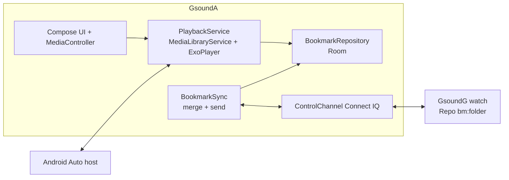

# Gsound — Phone Player, Android Auto and Bookmark Sync — Design

Implements `requirements.md` (PL-x). Written from the current code: the watch stores
`bm:<folder>` bookmarks in `Repo.mc`; the phone's control channel is `net/garmin/ControlChannel.kt`;
the watch's PING handler is `GsoundGApp.onPing`; `DebugLog.LogSender` is the model for a
one-in-flight send chain.

## 1. Architecture



- One service owns the player. The app UI, notification, lock screen and Android Auto are all
  clients of its `MediaSession` (Media3 `MediaLibraryService`).
- Bookmarks are a separate concern from the player: the service only writes them; `BookmarkSync`
  merges and talks to the watch.

## 2. Phone player (PL-1)

- Dependencies: `androidx.media3:media3-exoplayer`, `media3-session` (and `media3-ui` if the
  stock controls are used). Versions pinned in `libs.versions.toml`.
- `PlaybackService : MediaLibraryService` with `ExoPlayer` (`setAudioAttributes(...,
  handleAudioFocus = true)`, `setHandleAudioBecomingNoisy(true)`, `setWakeMode(WAKE_MODE_LOCAL)`).
- Manifest: exported service with the `androidx.media3.session.MediaLibraryService` intent
  filter, `foregroundServiceType="mediaPlayback"`, permission
  `FOREGROUND_SERVICE_MEDIA_PLAYBACK`. Media3 posts the media notification itself.
- Media items: `MediaItem` with the track's SAF `content://` URI as `uri`, a stable
  `mediaId` = the existing track id, and `MediaMetadata` (title, artist, album = folder,
  artwork).
  - ExoPlayer reads SAF URIs through `ContentResolver`; the persisted tree permission already
    belongs to the app process, which is the one that plays.
  - Revoked or missing files raise `PlaybackException`; the listener skips to the next item
    and posts a message (PL-1.7).
- Queue construction: `QueueBuilder(folderId)` reuses `NaturalOrder` for audiobooks and the
  stored order for music, so the chapter index equals the watch's `seq` index.
- In-app: `PlayerViewModel` holds a `MediaController` future bound to the service; state is
  exposed as `StateFlow<PlayerUiState>`. A `PlayerScreen` and a mini-player bar on the Folders
  screen.

## 3. Android Auto (PL-2)

- Manifest meta-data `com.google.android.gms.car.application` →
  `res/xml/automotive_app_desc.xml` with `<uses name="media"/>`.
- `MediaLibrarySession.Callback` implements:
  - `onGetLibraryRoot` returns a root item. Hosts may be restricted; the first version allows any
    caller (personal use) and the allow-list is a single function to tighten later.
  - `onGetChildren(parentId, page, pageSize)` returns, by id prefix:
    - `root` → three browsable nodes: `books`, `music`, `recent`;
    - `books` / `music` → folders (browsable);
    - `folder:<id>` → chapters/tracks (playable), paged;
    - `recent` → the last N played books, newest first (by bookmark `at`).
  - `onGetItem`, `onSetMediaItems` (expands a playable id into the whole folder queue and
    start index) and `onAddMediaItems`.
  - `onSearch`/`onGetSearchResult` for voice: case-insensitive title contains match over
    folders and chapters; fallback "continue last".
- Selecting an audiobook folder node → `onSetMediaItems` returns the queue with
  `startIndex` and `startPositionMs` from `BookmarkRepository.resolve(folder)`:
  - 5 s rewind, clamped at 0;
  - finished → chapter 1 at 0.
- Custom actions: `SessionCommand("gsound.skip_back_30")` / `("gsound.skip_fwd_30")`, exposed
  through `setCustomLayout`, shown only for audiobook queues. `seekBack/seekForward` increments
  are set to 30 s on the player.
- Artwork: the first version uses a bundled default icon. Embedded cover art is a later item
  (it needs a `ContentProvider` or a bitmap in `MediaMetadata.artworkData`).
- Testing: the Desktop Head Unit (SDK Manager → Android Auto Desktop Head Unit) with the phone
  in Android Auto developer mode and "Unknown sources" on. Documented in `INSTALL.md`.

## 4. Phone bookmark (PL-3)

### 4.1 Storage

Room, DB v2 → v3. New entity:

```kotlin
@Entity(tableName = "bookmarks")
data class BookmarkEntity(
    @PrimaryKey val folderId: String,   // FK-like to folders.id; deleted with the folder
    val folderName: String,             // the watch keys bookmarks by folder name
    val trackId: String,
    val chapterIndex: Int,
    val positionSec: Int,
    val finished: Boolean,
    val updatedAt: Long,                // epoch seconds; the merge key ("at")
    val source: String,                 // "phone" | "watch", last writer (for the UI)
    val lastSentAt: Long = 0,           // last `at` exchanged with the watch (PL-6.4)
)
```

- `MIGRATION_2_3` creates the table; `schemas/…/3.json` is exported; a JVM migration test is
  added like `MIGRATION_1_2`.
- `BookmarkDao`: `get(folderId)`, `observeAll()`, `upsert`, `delete(folderId)`, `markSent`.
- The folder delete / un-mark paths call `delete` (PL-3.6).
- `folderName` is stored because the watch's `bm:<folder>` key is the folder name. Open point:
  confirm that the manifest's folder name and `Folder.displayName` are the same string (§9).

### 4.2 Writing (`BookmarkRecorder`)

A `Player.Listener` plus a coroutine ticker in `PlaybackService`:

| Trigger | Write |
|---|---|
| `onIsPlayingChanged(false)`, `onPlaybackStateChanged(ENDED)` | current track + `currentPosition` |
| `onMediaItemTransition` | the new chapter at its start (0) or where playback began |
| `onPositionDiscontinuity` (seek) | new position |
| ticker, every 15 s while `isPlaying` | current track + position |
| `onDestroy`, `onTaskRemoved`, session disconnect | final write |

- Only for queues whose folder `isAudiobook`.
- Chapter complete → the transition event writes the next chapter at 0. The last chapter's
  `ENDED` sets `finished = true`.
- Positions are `positionMs / 1000`. Writes go through a single-thread `Dispatchers.IO`-based
  channel (conflated) so the player thread never blocks (PL-3.5).
- `updatedAt = now()` on every write, `source = "phone"`.
- Writes skipped when the new `(trackId, positionSec, finished)` equals the stored value.

### 4.3 Resolve (`BookmarkResolver`)

Same rules as the watch's `Bookmarks.resolve`: finished or empty → none; missing chapter →
chapter at the old index, position 0; otherwise rewind 5 s, clamp at 0. A pure function with
unit tests mirroring the watch's `AudiobookTests`.

## 5. Protocol (PL-4, PL-5)

One new message type, both directions: **`BOOKMARK`**.

```json
{ "v": 1, "type": "BOOKMARK", "pairingId": "…",
  "folder": "My Book", "trk": "<track id>", "idx": 2, "pos": 760, "fin": false, "at": 1790000000 }
```

- Flat: only strings, numbers, booleans (the same constraint as `LOG`; Connect IQ messages
  with nested arrays caused trouble before, see `DebugLog`).
- Optional field `fin` defaults to false if absent; unknown extra fields are ignored.
- Unknown `type` is already ignored by both ends (PL-7.5).
- `Messages.mc`: `TYPE_BOOKMARK`, `FIELD_FOLDER/TRK/IDX/POS/FIN/AT`, `buildBookmark(...)`, and
  `isValidType` extended. `Protocol` extractors validate types (String, Number, Boolean).
- Phone: `Bookmark` message class and `MessageCodec` entry, with a round-trip test.

## 6. Watch to phone: Refresh stats (PL-4)

Watch, in `GsoundGApp.onPing`, after `STATS` and `DebugLog.sendPending`:

```
BookmarkSender.sendAll(control, pairingId)
```

- `BookmarkSender` (new, `source/sync/BookmarkSender.mc`) is modeled on `LogSender`:
  - collects `Repo.bookFolders()` that have `Repo.loadBookmark`;
  - sends them one at a time, the next from the previous `onComplete`;
  - stops on `onError`; a guard prevents two chains from running at once;
  - never throws.
- It is a release feature (not `(:debug)`), so memory matters (PL-7.2): it builds one small
  dictionary at a time and keeps only an index and the folder array.
- To keep the PING reply fast, `LOG` forwarding (debug only) runs after the bookmarks.

Phone:

- `BookmarkSync` collects `ControlChannel.incoming` messages of type `BOOKMARK` (same place
  `STATS` is collected), validates `pairingId` and folder (PL-4.3), then calls `merge(...)`.
- "Refresh stats" in the existing ViewModel shows the merged bookmarks from
  `BookmarkDao.observeAll()`.

## 7. Phone to watch (PL-5)

Phone, after Refresh stats completes (STATS and the bookmark window closed, or a timeout of a
few seconds after the last `BOOKMARK`) and at the end of a successful sync:

```
for b in bookmarks where b.updatedAt > b.lastSentAt (and source/wins per merge):
    send BOOKMARK(b) ; on success markSent(b.updatedAt)
```

- Sequential, one in flight, with the existing retry/backoff of `ControlChannel.send`.

Watch: `control.setHandler(Messages.TYPE_BOOKMARK, method(:onBookmark))`, which calls
`BookmarkMerge.apply(msg)`:

1. Validate the pairing id, then `folder` is a book (`Repo.isBookFolder`), and `trk` is in
   `FolderTracks.orderedIds(folder)`. Else ignore and log.
2. If a playback session is active for that folder, ignore (PL-5.5). The control-channel
   process cannot see the playback process directly; use a marker in `Application.Storage`
   (`bm:live` = folder name, set by `BookSession` on START, cleared on STOP/COMPLETE). A stale
   marker is ignored after a timeout: the marker stores `at`, and is ignored when older than
   2 minutes.
3. Merge by §8 and, on win, `Repo.saveBookmark(folder, trk, pos, idx, fin)` with the **incoming
   `at`** (today `saveBookmark` stamps `Time.now()`; add an optional `at` argument).

## 8. Merge (PL-6)

A pure function on both platforms (Kotlin and Monkey C), same table of cases, tested on both:

```
merge(local, incoming, now):
    inAt = min(incoming.at, now + 300)        # clamp future timestamps
    if local == null:            take incoming
    elif inAt > local.at:        take incoming
    else:                        keep local     # equal or older
    # finished is not special beyond `at`: it only wins by being newer
```

- `lastSentAt` per book prevents ping-pong: after taking the incoming one, `lastSentAt` is
  set to its `at` so it is not echoed back.
- Clock skew: the watch clock follows the phone through Garmin Connect, so the skew is
  small. The 5-minute clamp only protects against bad future values. Equal `at` keeps local.
- Rewind is applied at resume time on each device, not stored (matches AB-6.1).

## 9. Risks and open points

| # | Risk / open point | Plan |
|---|---|---|
| R1 | SAF `content://` playback in ExoPlayer from a service | Prototype early (task 2). Fall back to opening a `ParcelFileDescriptor` data source if the tree URI misbehaves. |
| R2 | Folder name is the join key to the watch; renames or duplicates | **Resolved (task 1.1).** The manifest's `folder` is `Track.relativeFolder` (`ScanPaths.relativeFolder`): the slash-joined sub-folder path, and the root's `displayName` only for files directly under the root. So it does NOT equal `Folder.displayName` for nested books (e.g. `Book/CD1`), and two roots with the same display name collide. Fix: `ManifestTrack` now carries optional `fid` (= `Folder.id`, set by `ManifestBuilder`). Bookmarks are keyed by `fid` on the phone (`BookmarkEntity.folderId`). The watch must store `fid` per folder when parsing the manifest (follow-up for the watch/protocol tasks) and send it in `BOOKMARK` as the join key; `folder` stays a display label. |
| R3 | Android Auto only shows sideloaded apps in developer mode | Documented in INSTALL.md; DHU for dev. |
| R4 | Watch position is event-driven, so it can be stale | Known limitation (INSTALL.md). Newest `at` wins, so a staler watch value loses to a fresher phone one. |
| R5 | `Application.Storage` is shared across ACP processes; the live marker is eventually consistent | Marker has a timeout; worst case an incoming bookmark is ignored once and arrives on the next refresh. |
| R6 | Connect IQ message throughput and size | Flat small messages, one in flight, same pattern as `LOG`. |
| R7 | Position semantics on the watch (relative vs absolute, AB R2) | Already corrected in `BookSession` before saving; the phone consumes the stored absolute value. |
| R8 | Auto-applying a remote bookmark may surprise the user | Always visible in the Refresh stats list (device + chapter + position); the watch Resume label shows it. |

## 10. Testing

- JVM: `BookmarkResolver`, `BookmarkMerge` (table of cases), `BookmarkRecorder` throttling and
  triggers (fake `Player`), `QueueBuilder` order, `MessageCodec` round trip for `BOOKMARK`,
  the Room migration 2→3, `BookmarkSync` with the fake `ControlChannel`.
- Watch (`(:test)` in `source/test`): merge cases, `buildBookmark`, `BookmarkSender` chain
  with a fake transmit, apply rules (unknown folder, unknown track, live marker).
- Instrumented/manual: playback of a SAF track, notification controls, DHU browse and play,
  the car (voice, steering wheel), and the end-to-end flow in the tasks file.
