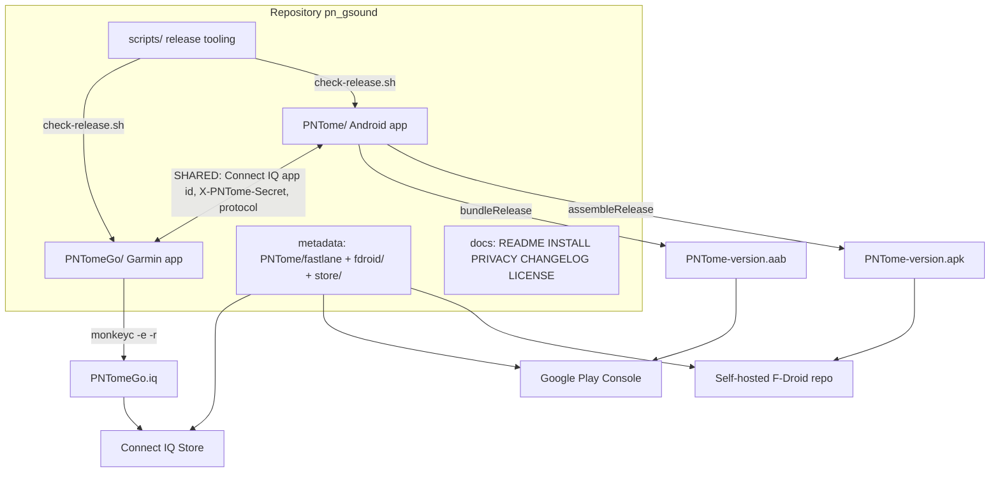

# Design Document: PNTome Store Release

## Overview

This feature prepares the repository for public distribution. The Android app (`GsoundA`) becomes **PNTome** and the Garmin Connect IQ watch app (`GsoundG`) becomes **PNTomeGo**. The repository is made ready for three channels: Google Play (AAB), a self-hosted F-Droid repository (APK + fastlane metadata + fdroid build metadata), and the Garmin Connect IQ Store (`.iq` export).

The work is mechanical rename plus release engineering: folders, Kotlin package, applicationId, strings, build scripts, signing, store listings, privacy policy, license, changelog and a release-check script. No product behaviour changes. Publishing, signing keys and store accounts are user actions and are documented, not automated.

Decisions made with the user (see Assumptions for the rest):

- **applicationId and Kotlin package**: change to `dev.pntome.app` (no release exists, so a clean change is cheap).
- **License**: `GPL-3.0-or-later`.
- **F-Droid**: self-hosted F-Droid repository only. Main F-Droid inclusion is out of scope because the Connect IQ Mobile SDK is a proprietary binary. The fdroid metadata file is still produced in a form that can later be submitted to fdroiddata.

## Findings From Repo Investigation

| Area | Current state | Consequence |
|---|---|---|
| Layout | `GsoundA/` (Gradle, Kotlin, 110 main + 56 test `.kt` files under `dev/gsound/a`), `GsoundG/` (Monkey C), root `README.md`, `INSTALL.md`, `test-media/`, `.kiro/` | git history is short (no release yet). `git mv` keeps history. |
| Gradle | `rootProject.name = "GsoundA"`, `namespace = applicationId = "dev.gsound.a"`, `compileSdk = targetSdk = 35`, `minSdk = 26`, `versionCode = 1`, `versionName = "0.1.0"` as literals in `app/build.gradle.kts`; `isMinifyEnabled = false`; no signing config; no `dependenciesInfo` block | Need signing from env, AAB, `dependenciesInfo` off, version single-source check |
| Manifest | label `@string/app_name` = "GsoundA"; theme `Theme.GsoundA`; `.GsoundApplication`; `allowBackup="true"`; services `SyncForegroundService` (dataSync) and `PlaybackService` (mediaPlayback, exported); Android Auto meta-data | Rename; revisit `allowBackup`; Play foreground-service declarations |
| Permissions | INTERNET, ACCESS_NETWORK_STATE, ACCESS_WIFI_STATE, CHANGE_WIFI_STATE, WAKE_LOCK, FOREGROUND_SERVICE, FOREGROUND_SERVICE_DATA_SYNC, FOREGROUND_SERVICE_MEDIA_PLAYBACK, POST_NOTIFICATIONS | All need Play justification (table below) |
| Persisted names | Room `gsound.db` (`GsoundDatabase.NAME`), DataStore files `pairing.pb`, `settings.pb`, `sync_summary.pb`, schemas dir `app/schemas/dev.gsound.a.data.folders.GsoundDatabase/{1,2,3}.json` | Rename DB; schema folder is derived from the database class FQN and must move with it |
| Strings / ids | `app_name`, notification channel id `gsound_sync`, intent actions `dev.gsound.a.action.{PLAY_URI,SYNC_START,SYNC_CANCEL}`, logcat tags `Gsound.HTTP`, `Gsound.CIQ`, `Gsound.Watch`, HTTP header `X-Gsound-Secret`, androidTest provider authority `dev.gsound.a.test.seededdocs` | Rename; header and `Gsound.Watch` tag are shared with the watch app |
| Shared constant | `GsoundAppId.VALUE = "0236dc0a39fd45f09a109f48fc8c7be2"` equals `GsoundG/manifest.xml` `<iq:application id=...>` | **Preserve.** The comment in `manifest.xml` requires byte equality |
| Garmin | `AppName`/`ProviderName` = "Gsound", entry `GsoundGApp`, classes `GsoundContentDelegate`, `GsoundSyncDelegate`, `build.sh` default output `build/GsoundG-<device>.prg`, `run_in_simulator.sh`, `sim/*.sh`, Version guard `Version.mc` vs `manifest.xml` (0.1.0), `dist/` and `build/` git-ignored | Rename; add `.iq` export |
| Docs | root `README.md`, root `INSTALL.md`, `GsoundA/INSTALL.md` (374 lines), `GsoundG/INSTALL.md` (362 lines), `GsoundA/docs/manual-e2e-checklist.md`; README states the app UUID is a placeholder, which is outdated (it already holds the real id) | Rewrite names, fix outdated statement |
| `.kiro` | specs `gsound-*` (historical), skills `connectiq-simulator` and `no-physical-devices` with `GsoundG/...` paths in `SKILL.md` | Update live skill paths; keep historical spec folders |
| Missing | no `LICENSE`, no `PRIVACY.md`, no `CHANGELOG.md`, no fastlane, no CI, no root `.gitignore` | Create |
| Proprietary dep | `com.garmin.connectiq:ciq-companion-app-sdk:2.4.0`; its POM license is the Garmin Connect IQ SDK License Agreement | Not FOSS. Documented as `NonFreeDep` anti-feature, and in `PRIVACY.md`/README |
| Google services | none among dependencies. Manifest string `com.google.android.gms.car.application` is only an Android Auto declaration, not a library | No trackers; no Play Services |

## Architecture



### Rename Order

The order keeps the tree buildable at each commit-sized step and keeps `git mv` history.

1. Pre-flight: clean working tree, record baseline (`./gradlew --offline testDebugUnitTest`, `monkeyc` build of `fenix6spro`).
2. `git mv GsoundA PNTome` and `git mv GsoundG PNTomeGo` (ignored build output stays behind and is removed).
3. Android Kotlin package: `git mv` `src/{main,test,androidTest}/java/dev/gsound/a` to `.../dev/pntome/app`; rewrite `package`/`import`, `java_package` in the three `.proto` files, manifest, `namespace`, `applicationId`; `git mv` the Room schema folder to `dev.pntome.app.data.folders.PNTomeDatabase`.
4. Class and file renames with a `Gsound` prefix (`GsoundApplication`, `GsoundDatabase`, `GsoundJson`, `GsoundLog`, `GsoundRouting`, `GsoundHttpServer`, `GsoundAppId`, ...) to `PNTome*`; strings, theme, channel id, actions, tags, header.
5. Garmin: strings, `entry`, class names, file names, build outputs, header, tag. **App id unchanged.**
6. Scripts, docs, skills, spec references.
7. Add release engineering (signing, AAB, metadata, check script).
8. Verify (offline Gradle, JVM tests, monkeyc builds, simulator).

Steps 3 to 5 must land together in one change set because the HTTP header and log tag are a cross-app protocol (see below).

### Rename Mapping

| Old | New | Notes |
|---|---|---|
| `GsoundA/` | `PNTome/` | git mv |
| `GsoundG/` | `PNTomeGo/` | git mv |
| `rootProject.name = "GsoundA"` | `"PNTome"` | |
| `dev.gsound.a` (namespace, applicationId, package, `java_package`) | `dev.pntome.app` | Clean change; documented below |
| `GsoundApplication`, `GsoundDatabase`, `GsoundJson`, `GsoundLog`, `GsoundRouting`, `GsoundHttpServer`, `GsoundAppId` | `PNTomeApplication`, `PNTomeDatabase`, `PNTomeJson`, `PNTomeLog`, `PNTomeRouting`, `PNTomeHttpServer`, `PNTomeAppId` | Use the IDE-grade semantic rename tool for symbols |
| `Theme.GsoundA` | `Theme.PNTome` | |
| `app_name` "GsoundA" | "PNTome" | User-facing strings that say "GsoundA"/"GsoundG" become "PNTome"/"PNTomeGo" |
| `gsound.db` | `pntome.db` | No migration needed: no release exists |
| `pairing.pb`, `settings.pb`, `sync_summary.pb` | unchanged | Not branded |
| `gsound_sync` (channel id) | `pntome_sync` | |
| `dev.gsound.a.action.*` | `dev.pntome.app.action.*` | |
| `Gsound.HTTP`, `Gsound.CIQ`, `Gsound.Watch` | `PNTome.HTTP`, `PNTome.CIQ`, `PNTome.Watch` | `Gsound.Watch` is emitted by the watch and filtered by the phone |
| `X-Gsound-Secret` | `X-PNTome-Secret` | Phone `SECRET_HEADER` and watch `Downloader.mc` change together |
| `dev.gsound.a.test.seededdocs` | `dev.pntome.app.test.seededdocs` | androidTest manifest |
| Watch `AppName`, `ProviderName` "Gsound" | "PNTomeGo" (AppName), "PNTomeGo" (ProviderName) | |
| `GsoundGApp`, `GsoundContentDelegate`, `GsoundSyncDelegate` | `PNTomeGoApp`, `PNTomeContentDelegate`, `PNTomeSyncDelegate` | `manifest.xml` `entry` updated |
| `build/GsoundG-<device>.prg` | `build/PNTomeGo-<device>.prg` | |
| `test-media/gsound-test-tone.mp3` | `test-media/pntome-test-tone.mp3` | Only if referenced; references updated |
| `.kiro/specs/gsound-*` | unchanged folder names | Historical record. A note in the README explains that these specs predate the rename |
| `.kiro/skills/*/SKILL.md` paths | `PNTomeGo/...` | Live tooling |
| Root dir `pn_gsound` | unchanged | Local checkout name; remote name is the user's choice |

### Decision: Kotlin package and applicationId

**Recommendation (accepted by the user): change both to `dev.pntome.app`.**

Justification:

- No release exists, so no installed base depends on `dev.gsound.a`. After the first Play or F-Droid publication the applicationId can never change, so this is the cheapest moment.
- `dev.gsound.a` carries the old brand into store URLs (`play.google.com/store/apps/details?id=...`), F-Droid package listing, intent actions and Room schema folder name.
- Keeping `namespace` equal to `applicationId` avoids the confusing split that Gradle allows.
- Cost: touching about 170 Kotlin files. It is mechanical (`package`, `import`, directory move) and fully covered by the existing 56 JVM tests plus compile of androidTest.

Consequences accepted:

- Developer installs of the old app (`dev.gsound.a`) stay as a separate app. Their data is not migrated.
- Assumption flagged: `dev.pntome.app` assumes the developer controls the `pntome.dev` namespace or accepts a reverse-DNS id without domain ownership. Google Play and F-Droid do not verify domain ownership. If the user wants a different id, only the single constant `APP_ID` in the check script and the rename mapping change.

### Decision: Connect IQ app id and cross-app contract

**Preserve `0236dc0a39fd45f09a109f48fc8c7be2`.**

- The id is the key used by the phone (`PNTomeAppId.VALUE`) to find the watch app, and by the watch to store its data (`Application.Storage`, paired state, synced media).
- Changing it would orphan sideloaded watch installs and force a new store listing identity for no benefit, since the id is not user-visible.
- `PNTomeGo/manifest.xml` and `PNTomeAppId.kt` keep byte equality, enforced by `check-release.sh`.
- The Connect IQ Store reuses the manifest id on first upload. The id must stay stable for later updates.
- The developer key (`developer_key.der`) used to sign `.iq` must be kept for all future uploads. This is a user action and is documented.

Shared protocol constants renamed in lockstep: header `X-PNTome-Secret`, tag `PNTome.Watch`. Because both apps are unreleased, no protocol version bump is required. Developers who have an old `.prg` sideloaded must reinstall the new watch build together with the new phone app. This is noted in `CHANGELOG.md` and `INSTALL.md`.

## Components and Interfaces

### Component 1: Gradle build (PNTome/app/build.gradle.kts)

**Purpose**: signed release APK/AAB, reproducible and F-Droid compatible.

```kotlin
// Signing is read from env or an ignored keystore.properties. Absent => release stays unsigned.
val keystoreProps = Properties().apply {
    val f = rootProject.file("keystore.properties")
    if (f.exists()) f.inputStream().use { load(it) }
}
fun signingValue(envName: String, propName: String): String? =
    System.getenv(envName) ?: keystoreProps.getProperty(propName)

android {
    namespace = "dev.pntome.app"
    defaultConfig {
        applicationId = "dev.pntome.app"
        versionCode = 1          // single literal: parsed by fdroid UpdateCheckData and check-release.sh
        versionName = "0.1.0"    // single literal
    }
    signingConfigs {
        val storeFile = signingValue("PNTOME_KEYSTORE_FILE", "storeFile")
        if (storeFile != null) {
            create("release") {
                this.storeFile = file(storeFile)
                storePassword = signingValue("PNTOME_KEYSTORE_PASSWORD", "storePassword")
                keyAlias = signingValue("PNTOME_KEY_ALIAS", "keyAlias")
                keyPassword = signingValue("PNTOME_KEY_PASSWORD", "keyPassword")
            }
        }
    }
    buildTypes {
        release {
            signingConfigs.findByName("release")?.let { signingConfig = it }
            isMinifyEnabled = false   // see "R8" decision
        }
    }
    // F-Droid and reproducible builds: do not embed the encrypted dependency blob.
    dependenciesInfo {
        includeInApk = false
        includeInBundle = false
    }
    base.archivesName = "PNTome"   // PNTome-<versionName>-release.apk via app/build outputs
}
```

**Responsibilities**:

- Use environment variables `PNTOME_KEYSTORE_FILE`, `PNTOME_KEYSTORE_PASSWORD`, `PNTOME_KEY_ALIAS`, `PNTOME_KEY_PASSWORD`, or `PNTome/keystore.properties` (ignored by git). Never commit a keystore or password.
- Produce unsigned release output when no signing input is present, so F-Droid and offline CI builds do not fail.
- Keep `versionCode` and `versionName` as plain literals so `fdroid checkupdates` and `check-release.sh` can parse them.

#### Decision: R8/minify

Keep `isMinifyEnabled = false` for the first release. Reasons: Hilt, Room, protobuf-lite, Ktor server (reflection and `slf4j` optional classes) and Media3 need verified keep rules, and there is no physical device to smoke-test a minified build (see Verification). The proguard file gets a comment explaining this. Enabling R8 with a mapping file is listed as a follow-up in the Notes of `tasks.md`, not in scope. Play accepts unminified apps.

#### Decision: target SDK

Keep `compileSdk = targetSdk = 35`. Google Play requires new apps and updates to target the latest-but-one API level on a yearly schedule. The release-check task re-reads the current Play target API policy (web) before the first upload and records the result in `store/play/README.md`. If level 36 is required, bumping is a separate follow-up that needs behavior testing on a device.

#### Decision: allowBackup

Set `android:allowBackup="false"`. Reasons: backed-up `pairing.pb` holds the shared secret of a specific watch pairing, SAF persisted-URI grants do not survive restore so restored folder rows would be dead, and the Room DB references those URIs. A restored state is therefore wrong, not helpful. Declaring `false` also avoids a Play data-safety question about backup.

### Component 2: Manifest and resources (PNTome/app/src/main)

**Purpose**: store-ready identity and permissions.

Changes: label and theme names, `.PNTomeApplication`, `allowBackup`, permission comments updated to the new name. Permission set is unchanged.

#### Permission and foreground-service justification (Play Console / `store/play/permissions.md`)

| Permission / type | Why | Play Console note |
|---|---|---|
| `INTERNET` | Binds the listening socket of the embedded HTTP server and serves files to the watch on the local network. No remote servers are contacted. | Data safety: no data leaves the local network |
| `ACCESS_NETWORK_STATE` | Detects the Wi-Fi or hotspot address to bind | |
| `ACCESS_WIFI_STATE`, `CHANGE_WIFI_STATE`, `WAKE_LOCK` | `WifiLock` during sync so transfers do not stall | |
| `FOREGROUND_SERVICE` + `FOREGROUND_SERVICE_DATA_SYNC` | `SyncForegroundService`: user-started transfer of music to the watch | Foreground service declaration form with a short video: user taps Sync, notification with Cancel shown |
| `FOREGROUND_SERVICE` + `FOREGROUND_SERVICE_MEDIA_PLAYBACK` | `PlaybackService` (Media3) plays audio with a media notification | Declaration form: audio playback core function |
| `POST_NOTIFICATIONS` | Sync progress and media notification; runtime request with rationale; sync works if denied | |
| (not requested) storage/media, Bluetooth, location | SAF folder picker; Garmin Connect Mobile owns Bluetooth | Listed to answer reviewer questions |

Android 15 limits `dataSync` foreground services to a cumulative time budget per 24 hours and calls `Service.onTimeout`. The implementation task checks `SyncForegroundService` for an `onTimeout(startId, fgsType)` override and adds one that stops the sync cleanly and informs the user if it is missing.

### Component 3: Release-check script (scripts/check-release.sh)

**Purpose**: single offline command that enforces the repo invariants listed under Correctness Properties.

```bash
# scripts/check-release.sh  -- exits non-zero and prints each violation
check_no_old_names()        # no "Gsound"/"gsound" outside allowlist (.kiro/specs/gsound-*, CHANGELOG history lines)
check_app_id_shared()       # PNTomeGo manifest id == PNTomeAppId.VALUE
check_versions()            # Android versionName == Garmin Version.mc SEMVER == manifest version
check_changelog_files()     # PNTome/fastlane/metadata/android/*/changelogs/<versionCode>.txt exists
check_store_text_limits()   # title <= 30, short_description <= 80, full_description <= 4000 chars
check_fdroid_metadata()     # fdroid/metadata/dev.pntome.app.yml has required keys and matching versionCode
check_no_secrets_tracked()  # git ls-files has no *.jks, *.keystore, keystore.properties, *.der, local.properties
check_license()             # LICENSE exists, contains GPL-3.0 text header; SPDX in README
```

**Responsibilities**: no network, no SDK needed, runs in under a few seconds. Documented in INSTALL and run by the verification plan.

### Component 4: Garmin build (PNTomeGo)

**Purpose**: renamed build plus Connect IQ Store export.

```bash
# build.sh additions (existing flags unchanged)
#   --export   build a store package for ALL manifest products:
#              monkeyc -e -r -f monkey.jungle -y "$CIQ_DEVKEY" -o dist/PNTomeGo-<version>.iq
# default output name: build/PNTomeGo-<device>.prg
```

- `--export` implies release (`-r`) and refuses `--debug`.
- The version guard (`Version.mc` SEMVER vs manifest) runs before export; the build also compares against the Android `versionName` through `check-release.sh`, not inside `build.sh`.
- `COMMIT` stamping continues; release exports stamp the tag commit, never a `-dirty` suffix (the script fails `--export` on a dirty tree).
- `*.iq` and `dist/` stay ignored.

### Component 5: Store metadata

#### Google Play (`PNTome/fastlane/metadata/android/en-US/` is the single source; Play text is copied from it)

```
PNTome/fastlane/metadata/android/en-US/
  title.txt                    # PNTome
  short_description.txt        # <= 80 chars
  full_description.txt         # <= 4000 chars
  changelogs/1.txt             # file name == versionCode, <= 500 chars
  images/
    README.md                  # exact image specs and how to capture; no fake screenshots committed
    icon.png                   # 512x512  (placeholder to be generated, see tasks; user may replace)
    featureGraphic.png         # 1024x500 (user-supplied)
    phoneScreenshots/          # >= 2, user-captured
store/play/
  README.md                    # step-by-step Play Console checklist (user actions)
  listing.md                   # category, contact, tags, content rating answers, target audience
  data-safety.md               # answers to the Data safety form
  permissions.md               # table above, for the Foreground service declarations
```

Draft listing text (assumption: English only, refined by the user):

- Title: `PNTome`
- Short: `Play your music and audiobooks, and sync them to your Garmin watch over Wi-Fi.`
- Full description covers: pick folders with the system picker, built-in player with audiobook mode, pair with watch by 6-digit code, sync over local Wi-Fi or phone hotspot, no accounts, no ads, no analytics, requires the free PNTomeGo watch app and Garmin Connect Mobile, supported watch models, Android Auto media app.

#### Data safety answers (`store/play/data-safety.md`)

- Data collected: none. Data shared: none. No account, no ads, no analytics, no third-party SDK that collects data.
- The Connect IQ Mobile SDK is a communication library to Garmin Connect Mobile on the same phone; it is declared in the data-safety notes as a local IPC integration. The user is asked to verify this wording in the console.
- Data in transit: audio transfer to the watch is plain HTTP on the user's local network, authenticated with a per-pairing shared secret. Do **not** claim "data is encrypted in transit". The honest answer is recorded and flagged for user review.
- Data deletion: all data is local; uninstalling removes it. No deletion request mechanism is needed.
- Target audience: not for children. Content rating questionnaire: no user-generated content, no violence; the app plays the user's own files.

#### F-Droid (self-hosted repo; `fdroid/`)

```
fdroid/
  README.md                        # how to run fdroidserver: init, update, deploy (user actions)
  config.example.yml               # no secrets; repo name, description, URLs placeholders
  metadata/dev.pntome.app.yml      # build metadata draft, usable also as fdroiddata MR draft
```

Draft `fdroid/metadata/dev.pntome.app.yml`:

```yaml
Categories:
  - Multimedia
License: GPL-3.0-or-later
AuthorName: PNTome contributors            # placeholder
WebSite: https://example.invalid/pntome    # placeholder, user supplies
SourceCode: https://example.invalid/pntome # placeholder
IssueTracker: https://example.invalid/pntome/issues
Changelog: https://example.invalid/pntome/blob/main/CHANGELOG.md

AntiFeatures:
  NonFreeDep:
    en-US: Depends on the proprietary Garmin Connect IQ Mobile SDK and needs the proprietary Garmin Connect Mobile app to talk to the watch.

AutoName: PNTome

RepoType: git
Repo: https://example.invalid/pntome.git

Builds:
  - versionName: 0.1.0
    versionCode: 1
    commit: v0.1.0
    subdir: PNTome/app
    gradle:
      - yes
    # No prebuild steps: the Connect IQ AAR is fetched from Maven Central by Gradle.

AutoUpdateMode: Version
UpdateCheckMode: Tags
UpdateCheckData: PNTome/app/build.gradle.kts|versionCode\s*=\s*(\d+)|.|versionName\s*=\s*"([^"]+)"
CurrentVersion: 0.1.0
CurrentVersionCode: 1
```

Key points:

- `NonFreeDep` is the correct anti-feature for the Connect IQ SDK. No `Tracking`, `Ads` or `NonFreeNet` apply (no remote network service is used by the app itself).
- The `UpdateCheckData` regex reads the two literals in `build.gradle.kts`, so they must stay single literals. `check-release.sh` validates this regex against the file.
- F-Droid builds need no Google Maven artifacts beyond AndroidX/AGP from `google()`; this is accepted by fdroidserver.
- `dependenciesInfo` off and `fastlane/metadata/android` text give a clean listing.
- Because the self-hosted repo signs with the user's own key, the Play upload key and the F-Droid repo key can differ. A user running both channels cannot cross-update between them; this is documented.

**Reproducible build note**: with `dependenciesInfo` off, fixed `versionCode`, no timestamps, and a tag build, two builds can match. A formal reproducibility claim is not made.

#### Garmin Connect IQ Store (`store/garmin/`)

```
store/garmin/
  README.md              # submission checklist: developer account, upload .iq, supported devices, review
  listing.md             # name PNTomeGo, short + long description, category (Music/Audio), what's new
  images.md              # required images: app icon, hero/screenshot specs, how to capture in simulator
```

- App listing text: PNTomeGo is the companion watch app for PNTome; syncs audiobooks and music from the phone over Wi-Fi, plays on the watch with bookmarks and resume; requires PNTome on the phone and Garmin Connect Mobile.
- Manifest: type `audio-content-provider-app`, permission `Communications`, 8 products, `minApiLevel 3.0.0`. No manifest change except `entry` and the unchanged id.
- Export: `./build.sh --export` produces `dist/PNTomeGo-<version>.iq`.
- Screenshots come from the Connect IQ simulator via the `connectiq-simulator` skill (user action to capture and upload). Current image dimensions and requirements are verified against the developer portal by the user at upload time; the doc says so.
- Launcher icon: existing 65x65 PNG is kept; renaming does not change the artwork.

### Component 6: Documentation

| File | Change |
|---|---|
| `README.md` | New name and layout, PNTome / PNTomeGo, install channels (Play, F-Droid repo, Connect IQ Store, build from source), license badge text, links to PRIVACY and CHANGELOG, fix outdated UUID statement, note about historical `gsound-*` specs |
| `INSTALL.md` (root) | Names and paths; add a "Release builds" section pointer |
| `PNTome/INSTALL.md` | Names/paths; add sections "Release signing", "Build APK and AAB", "Self-hosted F-Droid repo" |
| `PNTomeGo/INSTALL.md` | Names/paths; add "Export for the Connect IQ Store" |
| `PNTome/docs/manual-e2e-checklist.md` | Names/paths; add release-candidate smoke steps (user performs) |
| `PRIVACY.md` (root) | Privacy policy, plain language, English: no data collected, no analytics, local network only, permissions list, Garmin Connect Mobile and Connect IQ SDK note, contact placeholder. Linked from store listings (needs a public URL; user hosts or uses the repo raw URL) |
| `CHANGELOG.md` | Keep a Changelog format; `0.1.0` first public release entry; same text mirrored to `fastlane/.../changelogs/1.txt` |
| `LICENSE` | GPL-3.0-or-later full text. Source files get SPDX headers only through a documented `REUSE`-style note; headers are not added to 170 files (assumption, reduces churn) |
| `THIRD_PARTY.md` | Table of dependencies with license, with the Connect IQ SDK marked proprietary |
| `CONTRIBUTING.md` | Not created (out of scope) |
| `.gitignore` (root) | Add `*.jks`, `*.keystore`, `keystore.properties`, `*.der`, `.fdroid/`, `fdroid/repo/`, `fdroid/archive/`, `fdroid/config.yml`, `fdroid/keystore*`, `*.aab`, `*.apk`, `*.iq` |
| `PNTome/.gitignore` | Add `keystore.properties`, `*.jks`, `*.keystore` |

GPL note: the Connect IQ SDK license is not GPL-compatible in the "linking" sense. Distributing a GPL app that links a proprietary library is legally nuanced. The design adds an explicit "additional permission / system library" caveat as an open item in `THIRD_PARTY.md` and tells the user to confirm it (not legal advice). This is flagged in Assumptions.

## Data Models

### Version contract

```
AndroidVersion  = { versionName: "MAJOR.MINOR.PATCH", versionCode: positive int }
GarminVersion   = { SEMVER (Version.mc), manifest version }
Invariant       : AndroidVersion.versionName == GarminVersion.SEMVER == GarminVersion.manifest version
VersionCode     : monotonically increasing; policy versionCode = MAJOR*10000 + MINOR*100 + PATCH is NOT used
                  initially (versionCode = 1); simple increment per release to keep fdroid tag parsing simple
Changelog file  : fastlane/metadata/android/en-US/changelogs/<versionCode>.txt
Git tag         : v<versionName>
```

### Shared cross-app contract

```
SharedContract = { connectIqAppId: hex32, secretHeader: "X-PNTome-Secret", watchLogTag: "PNTome.Watch" }
Phone side     : PNTomeAppId.VALUE, SECRET_HEADER, WATCH_LOG_TAG
Watch side     : manifest.xml id, Downloader.mc header, DebugLog tag
```

## Sequence: Release flow (user actions marked)

```mermaid
sequenceDiagram
    participant Dev as Developer (user)
    participant Chk as scripts/check-release.sh
    participant Gr as Gradle
    participant Mc as monkeyc
    participant Pl as Google Play Console
    participant Fd as fdroidserver (self-hosted)
    participant Cs as Connect IQ Store
    Dev->>Chk: run
    Chk-->>Dev: OK or list of violations
    Dev->>Gr: PNTOME_KEYSTORE_* set; bundleRelease and assembleRelease
    Gr-->>Dev: PNTome.aab, PNTome.apk
    Dev->>Mc: build.sh --export
    Mc-->>Dev: PNTomeGo-version.iq
    Dev->>Pl: upload AAB, listing, data safety, FGS declarations
    Dev->>Fd: fdroid update with metadata dev.pntome.app.yml, deploy
    Dev->>Cs: upload .iq, listing, screenshots
```

## Error Handling

### Scenario 1: Signing inputs missing
**Condition**: `bundleRelease`/`assembleRelease` without keystore env or file.
**Response**: build succeeds with an unsigned artifact and prints a Gradle `logger.warn` naming the missing variable names (never values).
**Recovery**: set the variables and rebuild.

### Scenario 2: Partial signing inputs
**Condition**: keystore file present but password/alias missing.
**Response**: fail the configuration with a message listing the missing names, so an unsigned artifact is not produced by mistake.
**Recovery**: supply the missing values.

### Scenario 3: Version drift
**Condition**: Android and Garmin versions differ or a changelog file is missing.
**Response**: `check-release.sh` exits 1 with each violation on its own line. `build.sh` still guards `Version.mc` vs manifest.
**Recovery**: bump consistently.

### Scenario 4: Old name remains
**Condition**: grep finds `Gsound`/`gsound` outside the allowlist.
**Response**: script prints file:line.
**Recovery**: rename or add a justified allowlist entry.

### Scenario 5: Dirty tree export
**Condition**: `build.sh --export` on a dirty working tree.
**Response**: abort with message.
**Recovery**: commit or stash.

### Scenario 6: Shared id mismatch
**Condition**: manifest id differs from `PNTomeAppId.VALUE`.
**Response**: check script fails.
**Recovery**: restore the preserved id.

## Testing Strategy

### Unit Testing Approach

The rename is verified by the existing suites, not new product tests:

- `./gradlew --offline testDebugUnitTest testReleaseUnitTest` (JVM, Robolectric, Ktor test-host).
- `./gradlew --offline assembleDebugAndroidTest` to compile instrumented tests (they cannot run: no device).
- `./gradlew --offline lintRelease`.
- `./gradlew --offline assembleRelease bundleRelease` unsigned, and again signed with a throwaway keystore generated in a temp dir (deleted afterwards) to prove the signing wiring. `apksigner verify` and `bundletool`-free checks: unzip the AAB and inspect `AndroidManifest`/`BundleConfig.pb` presence.
- Room: JVM migration test reads exported schemas from the moved folder; it must still pass.
- Monkey C: `monkeyc` builds for every product in the manifest (release and debug), unit tests (`Test.mc` files under `source/test`) via the `connectiq-simulator` skill, and `--export` produces a `.iq`.
- A new shell test for `check-release.sh`: run against the repo (expect OK) and against a temp copy with injected violations (expect each fails). Plain bash, no framework.

### Property-Based Testing Approach

Not applicable to this feature. The work is renaming, configuration and documents. The universal repository invariants are enforced by `check-release.sh` (a deterministic scan), not by generated inputs. No property-test library is added.

### Integration Testing Approach

- Manifest check on the merged release manifest: package/applicationId, label, services and permissions match the table.
- Cross-app contract check: header string and tag appear in both trees, app id equal.
- Simulator smoke run with the connectiq-simulator skill: the renamed `.prg` loads, no runtime error at startup.
- **Cannot be verified** (no physical devices, see the `no-physical-devices` skill): installing on a phone, Play pre-launch, Android Auto, real watch sync, F-Droid server run against a real remote, store uploads. These are listed in `store/*/README.md` as user steps and in the manual checklist.

## Performance Considerations

None materially. Release builds are unminified (no startup change). AAB lets Play deliver per-ABI/density splits; no native libraries are shipped.

## Security Considerations

- Keystores, passwords, `.der` developer key and fdroid repo keys are never committed; `.gitignore` and `check-release.sh` enforce this. Scripts print variable names only.
- `allowBackup=false` prevents exfiltration of the pairing secret by backup.
- The exported `PlaybackService` is a standard Media3 service. It is kept exported for MediaController/Android Auto; its intent action `dev.pntome.app.action.PLAY_URI` is handled inside the service. Reviewers may ask; documented in `permissions.md`.
- LAN transfer is cleartext HTTP guarded by a shared secret; documented honestly in PRIVACY and data-safety.

## Dependencies

- Build: JDK 17, Android SDK 35, Gradle 8.9 wrapper (already present), Connect IQ SDK 9.2.0 and a developer key (user machine).
- Optional user tools for publishing (not installed by this spec): `fdroidserver`, `apksigner`/Android build-tools (for verification), `keytool` (JDK). If a package is missing on Ubuntu, the task reports `sudo apt install <pkg>` to the user instead of installing it.
- Runtime third-party: unchanged. `com.garmin.connectiq:ciq-companion-app-sdk:2.4.0` is proprietary (Garmin license); everything else is AndroidX/Kotlin/Ktor/Hilt/Room/Media3 (Apache-2.0) and protobuf-javalite (BSD-3).

## Assumptions and Open Items (flagged for the user)

1. `dev.pntome.app` is used as the applicationId; the user does not need to own a domain.
2. Contact e-mail, website, source URL, issue tracker and privacy policy URL are placeholders (`example.invalid`) and must be replaced before submission. The check script reports remaining `example.invalid` occurrences as warnings in `--release` mode.
3. English (`en-US`) is the only listing locale.
4. GPL-3.0-or-later with a proprietary Connect IQ SDK dependency needs the user's confirmation (possibly an additional permission note). This is not legal advice.
5. Store images (icon 512, feature graphic, screenshots) cannot be produced without a device or design input; instructions and placeholders only. No fake screenshots are committed.
6. Google Play target-API policy and Connect IQ Store image/field requirements change over time; the user must re-check them at submission.
7. R8 stays off for the first release.
8. `.kiro/specs/gsound-*` folders keep their names as historical records.
9. Main F-Droid inclusion is out of scope per the user's choice. The metadata file stays valid for a later fdroiddata submission, which will likely require resolving the proprietary SDK question.
